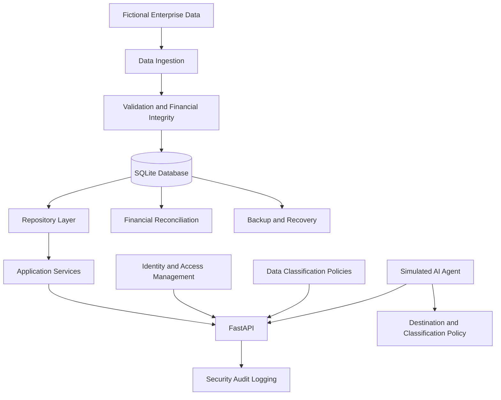

# Secure Enterprise Data & Systems Platform

An interdisciplinary enterprise engineering project combining data engineering, software architecture, financial data integrity, infrastructure engineering, cybersecurity and secure AI integration within a controlled local environment.

## Project Overview

Enterprise systems must balance operational efficiency, data accessibility, financial accuracy and security. As organizations increasingly integrate automated workflows and AI-enabled applications, maintaining control over sensitive information and business-critical processes becomes increasingly important.

This project explores how these requirements can be addressed through an integrated enterprise platform using a fictional consulting organization as its business context.

Rather than treating data engineering, infrastructure and cybersecurity as separate disciplines, the platform incorporates them into a shared system with explicit security boundaries, financial validation controls and architectural separation.

## Engineering Objectives

- Build reliable and repeatable financial data ingestion pipelines.
- Maintain exact monetary precision and transactional integrity.
- Separate business logic from infrastructure and API components.
- Enforce identity-based authorization and data classification policies.
- Protect sensitive resources against unauthorized AI-mediated access.
- Establish hardened and isolated containerized infrastructure.
- Validate database backup, restoration and operational reliability.
- Verify system behavior through automated regression testing.

## System Architecture

The application operates within a hardened Docker environment. AI security scenarios are implemented using deterministic local simulations rather than external models or AI providers.

## Engineering Disciplines

| Discipline | Implementation |
|---|---|
| Data Engineering | CSV ingestion, schema validation, duplicate prevention, transactional processing and reconciliation |
| Enterprise Architecture | Domain models, repository interfaces, application services and dependency injection |
| Financial Engineering | Integer-based monetary storage, exact decimal calculations and controlled financial corrections |
| Database Engineering | Relational storage, transactional migration, integrity validation and read-only reporting |
| Infrastructure Engineering | Docker containerization, local offline builds, persistent storage and runtime isolation |
| Cybersecurity | Identity management, credential hashing, role-based authorization and security auditing |
| Data Governance | Classification-based access restrictions and financial correction approval controls |
| AI Security | Simulated indirect prompt injection, unauthorized resource access and exfiltration policy validation |
| Systems Reliability | Database backups, restoration, persistence verification and regression testing |
| Workflow Orchestration | Prefect workflow definition and independently verified pipeline integration |

## Verification Results

| Verification area | Result |
|---|---|
| Automated regression tests | 177 passed, 0 failed |
| Security and AI regression subset | 54 passed |
| Isolated financial pipeline integration | 175 transactions and 5 projects |
| Operational database migration | 177 transactions and 5 projects |
| Financial reporting | Exact decimal reconciliation verified |
| Database recovery | Integrity and restored data equivalence verified |
| Offline Docker image build | Successful |
| Containerized API health | HTTP 200 |
| Containerized financial reconciliation | Successful |
| Container network isolation | Network mode: none |
| Container filesystem | Read-only root filesystem |
| Container privileges | Non-root user, all capabilities dropped |

The security regression subset is included in the 177 total automated tests.

## Technical Documentation

- [Enterprise Architecture](docs/architecture.md)
- [Data Engineering and Financial Integrity](docs/data-engineering.md)
- [Infrastructure and Containerization](docs/infrastructure.md)
- [Cybersecurity and Data Governance](docs/cybersecurity.md)
- [AI Agent Security](docs/ai-security.md)
- [Reliability and Database Recovery](docs/reliability.md)
- [Testing and Technical Verification](docs/testing.md)
- [Engineering Evidence](evidence/README.md)

## Technology Stack

- Python
- FastAPI
- SQLite
- Docker
- Docker Compose
- Prefect
- Pytest
- Git
- PowerShell

## Security and Ethical Scope

All development and security verification activities were conducted against locally controlled application components and fictional enterprise data.

AI security scenarios do not involve external language models, real data exfiltration or unauthorized third-party systems.

The project is an enterprise engineering demonstrator, not a production-certified platform.

## Known Limitations

- AI security scenarios use deterministic simulations rather than live language models.
- The scheduled Prefect workflow is defined but has not been validated as a continuously running service.
- Authenticated API execution inside the final Docker container has not been independently verified.
- Backup and restoration verification covers the financial database rather than complete infrastructure disaster recovery.
- The offline Docker build depends on an existing local base image.
- The final regression suite reports one non-blocking dependency deprecation warning.

## Project Status

Technical implementation and verification completed within the defined project scope.
