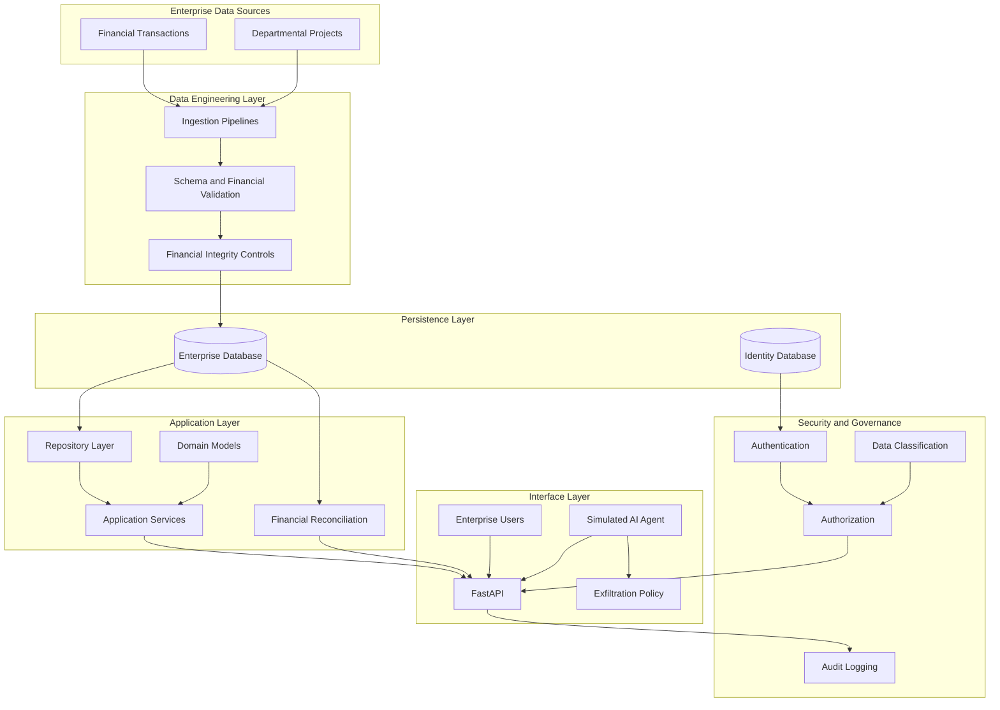
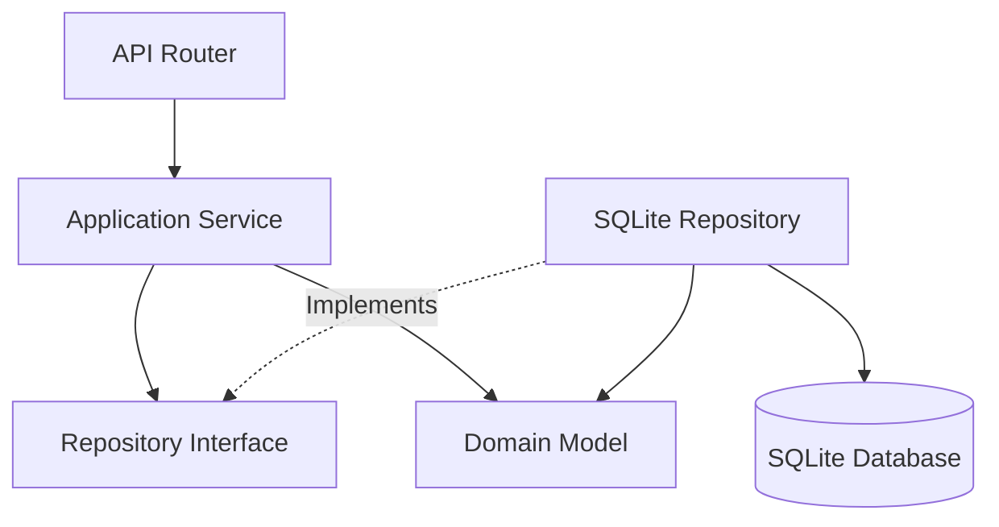
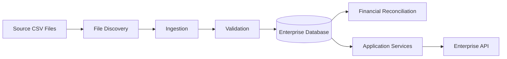
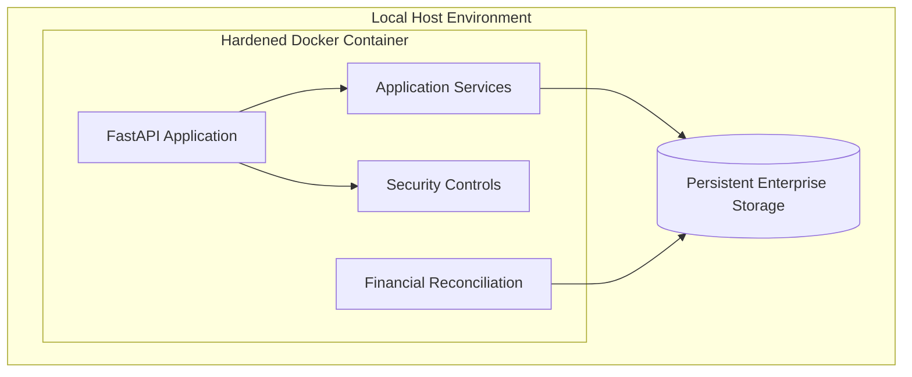

# Enterprise Architecture & System Design

## 1. Architectural Overview

The Secure Enterprise Data & Systems Platform was designed to explore the intersection of enterprise architecture, data engineering, infrastructure, financial governance and cybersecurity.

The platform represents a fictional consulting organization in which financial transactions, departmental projects, employee identities and AI-enabled applications operate within a shared enterprise environment.

The principal architectural challenge was to establish a system in which information remains accessible to authorized business functions without compromising financial integrity, security or operational reliability.

## 2. Architectural Principles

The system was developed around seven fundamental engineering principles.

| Principle | Architectural Application |
|---|---|
| Separation of Concerns | Independent domain, application, infrastructure and API responsibilities |
| Modularity | Separation of financial pipelines, security controls and AI security mechanisms |
| Least Privilege | Identity-based access restrictions and restricted container privileges |
| Defence in Depth | Security controls across application, data and infrastructure layers |
| Data Integrity | Transactional processing, exact monetary representation and controlled corrections |
| Secure by Design | Authorization and classification incorporated into application design |
| Operational Resilience | Persistent storage, database recovery and regression testing |

## 3. High-Level System Architecture



The architecture separates data processing, persistence, business logic, access control and application interfaces into distinct responsibilities.

## 4. Layered Application Architecture

The departmental project subsystem implements a layered architecture influenced by Clean Architecture and domain-driven design principles.

```text
app/
├── api/
│   ├── dependencies.py
│   └── routes/
│       └── projects.py
└── projects/
    ├── domain/
    │   └── project.py
    ├── application/
    │   ├── ports.py
    │   └── project_service.py
    └── infrastructure/
        └── project_repository.py
```

### Domain Layer

The domain layer defines core business entities, financial values and project-related rules independently of HTTP requests and database implementation details.

Its responsibilities include:

- Project domain modelling.
- Financial value validation.
- Data classification representation.
- Project approval and AI-access eligibility representation.
- Typed and immutable business entities.

### Application Layer

The application layer coordinates business operations and defines the interfaces required to retrieve enterprise information.

Repository interfaces establish a boundary between application logic and persistence technologies, reducing direct dependencies on database implementation details.

### Infrastructure Layer

The infrastructure layer implements database access through SQLite-backed repositories.

Database-specific operations, query execution and conversion of persisted records into domain objects are handled independently of API routing.

Read-only database access and restricted data projections reduce unnecessary access to underlying enterprise records.

### API Layer

The API layer exposes enterprise functionality through FastAPI.

Its responsibilities include request handling, dependency injection, identity verification, authorization, response construction and security audit integration.

The API acts as a controlled access boundary rather than allowing consumers to interact directly with enterprise databases.

## 5. Dependency Management and Inversion



The application service depends on a repository abstraction rather than directly implementing SQL queries.

Dependency injection connects the application service to its concrete repository implementation.

This architectural approach provides several advantages:

- Reduced coupling between business logic and persistence.
- Improved component testability.
- Greater maintainability.
- Clearer architectural boundaries.
- Potential for future replacement of persistence technologies.

The layered architecture is implemented specifically within the departmental project subsystem. Other application components retain a more direct modular structure.

## 6. Enterprise Data Architecture

The platform separates business information from identity management through distinct SQLite databases.

| Data Component | Responsibility |
|---|---|
| Financial Transactions | Enterprise revenue and expenditure records |
| Departmental Projects | Project information, budgets and commercial values |
| Ingestion History | Processing status and source file identification |
| Financial Correction Registry | Authorized modifications to existing transactions |
| Identity Database | Application identities and credential lifecycle management |
| Security Audit Log | Recorded security and access-control events |

### Financial Data Integrity

Monetary values are represented as integer cents at the persistence layer and converted into exact decimal values for business calculations.

This design avoids binary floating-point inaccuracies in financial processing.

Additional integrity controls include transactional ingestion, source file hashing, duplicate detection, controlled correction approval and read-only financial reconciliation.

## 7. Enterprise Systems Integration



The platform integrates financial processing, project management, business reporting and security controls into a shared application environment.

A Prefect workflow definition coordinates database initialization, financial ingestion, departmental project ingestion, incoming file discovery and reconciliation.

The underlying workflow sequence was independently executed and verified against an isolated database.

The scheduled Prefect service itself was not deployed or runtime-validated.

## 8. Security Architecture

Security controls are integrated across multiple system boundaries.

| Architectural Boundary | Security Control |
|---|---|
| Identity | Credential hashing, identity status and credential lifecycle controls |
| Application | Role-based and classification-based authorization |
| Data | Restricted queries and read-only reporting |
| Financial Processing | Transaction validation and controlled correction approval |
| AI Integration | Backend-enforced authorization and simulated exfiltration policies |
| Infrastructure | Non-root execution, restricted privileges and container isolation |
| Accountability | Security event logging |

The system does not rely on client-provided role claims as an authorization mechanism. Resource access is evaluated against authenticated application identities and applicable access policies.

AI agents are treated as potentially untrusted consumers of enterprise functionality.

The AI security subsystem models indirect prompt injection and unauthorized data-transfer requests without connecting to external language models or transferring information externally.

## 9. Infrastructure Architecture



The application was containerized using Docker, with a dedicated offline build configuration referencing an existing local image.

The final verification container used the following security configuration:

- Non-root application user.
- Disabled external container networking.
- Read-only root filesystem.
- All Linux capabilities dropped.
- No-new-privileges security configuration.
- Read-only enterprise database mount.
- No published host ports.

This configuration was used to verify isolated application execution, API health and financial reconciliation.

## 10. Architectural Decisions and Trade-offs

| Decision | Rationale | Trade-off |
|---|---|---|
| Modular monolith | Simplify deployment and system coordination | Components do not scale independently |
| SQLite persistence | Lightweight relational storage and local reproducibility | Limited suitability for high-concurrency enterprise workloads |
| Layered project architecture | Separate domain logic from infrastructure | Additional abstractions and implementation complexity |
| Integer monetary storage | Preserve exact financial precision | Explicit monetary conversion required |
| Centralized authorization | Consistent access-control decisions | Security depends on correct policy implementation |
| Hardened containers | Reduce privileges and infrastructure exposure | Writable application operations require dedicated storage |
| Deterministic AI simulation | Controlled and repeatable security scenarios | Does not reproduce full language-model behaviour |
| Local offline image builds | Reduce external dependency retrieval during verification | Requires a previously available base image |

These decisions prioritize architectural clarity, financial integrity, security and reproducibility within the constraints of a local engineering environment.

## 11. Architectural Verification

The architecture was evaluated through component-level testing, integration testing, database verification and container runtime validation.

| Verification Area | Observed Result |
|---|---|
| Full automated regression suite | 177 passed, 0 failed |
| Security and AI regression subset | 54 passed |
| Isolated data pipeline integration | 175 financial transactions and 5 projects |
| Operational database migration | 177 financial transactions and 5 projects |
| Containerized application health | HTTP 200 |
| Containerized financial reconciliation | Exact monetary results verified |
| Database recovery | Integrity and restored data equivalence verified |

The security regression subset forms part of the full automated regression suite.

## 12. Architectural Limitations

The platform is an enterprise engineering demonstrator rather than a production deployment.

The following areas remain outside the completed verification scope:

- Distributed infrastructure and horizontal scalability.
- High-availability database configurations.
- Production identity provider integration.
- Live language-model integration.
- Authenticated API execution inside the final verification container.
- Continuous workflow scheduling and production monitoring.
- Infrastructure-wide disaster recovery.

## 13. Engineering Outcomes

The project demonstrates the integration of multiple engineering disciplines within a coherent enterprise system.

Its architectural value lies in connecting financial data processing, domain modelling, application services, identity management, infrastructure security and operational reliability rather than implementing these capabilities as isolated technical exercises.

---

[Return to Project Overview](../README.md)
