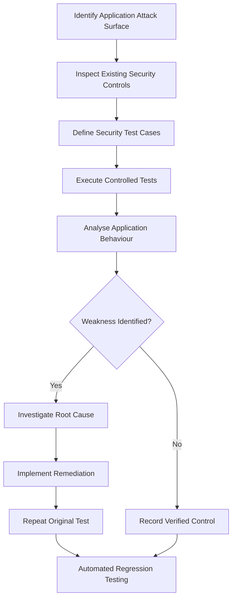
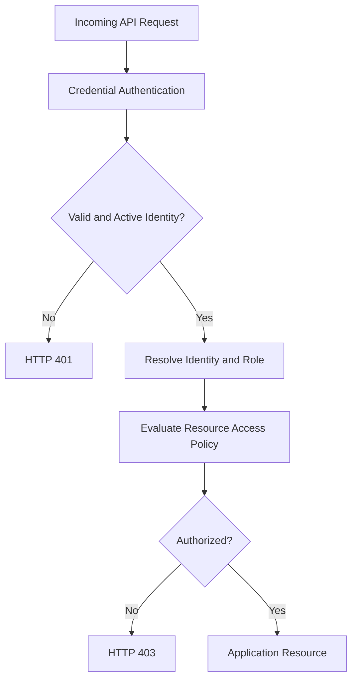
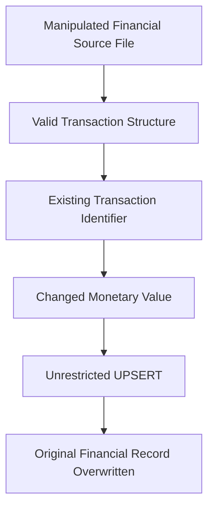
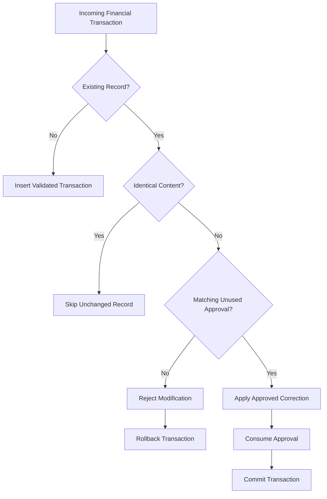

# Cybersecurity & Application Security Assessment

## 1. Overview

The security component of this project focuses on protecting enterprise information, application endpoints, financial processing workflows and service identities.

I approached security from both an offensive and defensive perspective. The objective was to identify weaknesses in the application, reproduce their consequences under controlled conditions, implement appropriate controls and verify that the remediation worked without breaking legitimate business functionality.

The assessment covered:

- API security and access control testing.
- Identity and access management (IAM).
- Credential lifecycle management.
- Business-logic vulnerability assessment.
- Financial data poisoning.
- Data classification and information protection.
- Security audit logging.
- Automated security regression testing.
- Simulated AI-agent security testing.
- Container and infrastructure hardening.

All security testing was conducted against locally controlled application components using fictional enterprise data. External systems and third-party infrastructure were outside the assessment scope.

## 2. Assessment Methodology

I combined application source-code inspection, manual security testing, database inspection and automated regression tests.

The general assessment process was:



I used temporary databases for destructive or state-changing security scenarios wherever applicable. This was particularly important when testing credential revocation, financial transaction manipulation and unauthorized corrections.

### Tools and techniques

| Tool | Application |
|---|---|
| PowerShell | Manual API requests and local security verification |
| Python | Security policy implementation and controlled attack simulation |
| pytest | Automated security and regression testing |
| FastAPI TestClient | In-process API security tests |
| SQLite | Database inspection and integrity verification |
| hashlib | Cryptographic hashing |
| Docker | Infrastructure isolation and runtime hardening |
| Git | Tracking security changes and remediation checkpoints |

## 3. API Security Assessment

The initial assessment focused on identifying application endpoints and understanding how the backend handled authentication, authorization and malformed requests.

### Application attack surface

| Endpoint | Function | Security Consideration |
|---|---|---|
| `/health` | Application health | Dependency availability |
| `/documents/{document_id}` | Enterprise document retrieval | Unauthorized resource access |
| `/finance/projects` | Financial reporting | Confidential information exposure |
| `/departments/strategy/projects` | Departmental project information | Department-specific permissions |
| `/ai/projects` | AI-eligible project information | Classification and AI access restrictions |
| `/operations/ingestion-status` | Processing status | Operational information exposure |

The endpoint inventory was used to establish the application attack surface. Individual authorization and validation scenarios were subsequently evaluated against the relevant endpoints.

### Authentication and authorization testing

I tested requests using different fictional organizational identities, missing credentials, invalid credentials and modified tokens.

| Test Scenario | Observed Behaviour |
|---|---|
| Missing authentication credential | HTTP 401 |
| Invalid authentication credential | HTTP 401 |
| Tampered credential | Authentication rejected |
| Employee requesting unauthorized Finance document | HTTP 403 |
| Unauthorized departmental access | Access denied |
| Authorized financial access | Permitted |
| Malformed document identifier | HTTP 422 |

The distinction between HTTP 401 and HTTP 403 was particularly useful when troubleshooting security tests.

HTTP 401 indicates that the application could not establish a valid authenticated identity. HTTP 403 indicates that an identity was authenticated but lacked the required permissions.

### Access control testing

I evaluated whether an authenticated user could access resources associated with another organizational role.

The scenarios covered unauthorized access to Finance information, departmental resources and classified enterprise documents.

The objective was to identify potential broken access control and vertical privilege escalation weaknesses.

The tested authorization controls rejected unauthorized resource requests.

These checks establish baseline API security behaviour rather than comprehensive penetration-testing coverage of every application endpoint.

## 4. Identity and Access Management

The application uses a local identity registry that separates human users from service identities.

This allows authorization decisions to depend on authenticated identities rather than roles or permissions claimed by an incoming request.



### Role separation

The identity model distinguishes between several organizational responsibilities.

| Identity or Role | Intended Responsibility |
|---|---|
| Employee | General enterprise information access |
| Strategy | Departmental project information |
| Finance | Authorized financial information access |
| Finance Approver | Controlled financial correction approval |
| AI Service | Explicitly permitted AI-related information access |

Access decisions also consider the requested resource and its associated information classification.

### Credential lifecycle management

The identity registry supports hashed credential storage, identity status management, credential expiration, revocation and rotation.

The assessment covered:

- Authentication with valid and invalid credentials.
- Rejection of disabled identities.
- Identity reactivation.
- Credential hashing.
- Expired credential rejection.
- Credential revocation.
- Credential rotation.
- Rejection of previously rotated credentials.
- Persistence of identity status across application executions.
- Separation of human and AI service identities.

### Identity isolation and testing

Credential lifecycle tests can modify identity records. To prevent these operations from affecting the normal application environment, I used pytest fixtures to redirect the identity registry to a temporary database.

Relevant fixture design:

```python
@pytest.fixture(autouse=True)
def isolated_identity_database(tmp_path, monkeypatch):
    database_path = tmp_path / "test_identity.db"

    monkeypatch.setattr(
        identity_module,
        "IDENTITY_DATABASE_PATH",
        database_path,
    )

    initialize_identity_registry()
```

This provides independent identity records for individual test cases and reduces dependencies between tests.

The final identity regression suite returned 17 successful tests.

The authentication implementation is intended for a controlled demonstration environment. It is not a replacement for production identity federation, enterprise single sign-on or centralized secrets management.

## 5. SEC-BIZ-001: Financial Data Poisoning

### Finding summary

| Attribute | Description |
|---|---|
| Finding ID | SEC-BIZ-001 |
| Vulnerability | Unauthorized modification of existing financial transactions |
| Category | Business-logic vulnerability / Data integrity |
| Affected component | Financial ingestion pipeline |
| Security impact | Unauthorized modification of financial records |
| Exploitation prerequisite | Manipulated source data reaching the ingestion process |
| Status | Remediated within the tested scope |

### Initial investigation

While reviewing the financial ingestion pipeline, I examined how the application handled existing transaction identifiers.

The pipeline used an SQL UPSERT mechanism that allowed existing financial records to be updated when a source file contained different transaction information.

This supported legitimate financial corrections, but it did not initially establish whether the proposed modification had been authorized.

The security weakness was not conventional SQL injection. The incoming record could satisfy schema validation and still introduce an unauthorized financial modification through the application's intended processing logic.

### Vulnerability reproduction

I created an isolated SQLite database and imported a fictional financial transaction with an original value of EUR 12,500.

A second CSV file was then generated using the same transaction identifier but with the financial amount changed to EUR 1.

Simplified representation of the manipulated records:

| Field | Original Record | Manipulated Record |
|---|---|---|
| Transaction ID | 990001 | 990001 |
| Transaction type | Revenue | Revenue |
| Classification | Confidential | Confidential |
| Amount | EUR 12,500.00 | EUR 1.00 |

Both source files were processed using the existing financial ingestion function.

The database was queried directly before and after the manipulated import.

### Original verification output

```text
test_ingestion.py::test_security_financial_data_poisoning

SEC-BIZ-001 original amount: EUR 12500.0
SEC-BIZ-001 modified amount: EUR 1.0

PASSED

1 passed in 0.10s
```

In this initial test, a passing result meant that the vulnerability had been successfully reproduced.

The original financial record was overwritten by the manipulated source data.

### Potential business impact

| Metric | Value |
|---|---:|
| Original transaction | EUR 12,500.00 |
| Manipulated transaction | EUR 1.00 |
| Revenue reduction | EUR 12,499.00 |
| Percentage reduction | 99.992% |

In an enterprise environment, this type of vulnerability could affect financial reporting, revenue reconciliation, project performance analysis and business decision-making.

The tested impact was limited to fictional records in an isolated database.

The assessment did not establish that an external attacker could independently obtain write access to the incoming financial source directory.

### Root cause

The investigation identified a distinction between data validation, source identification and authorization.

The original ingestion pipeline could:

- Validate transaction fields.
- Identify existing transaction records.
- Calculate cryptographic source file hashes.
- Detect previously processed source files.
- Update changed financial records.

However, these controls did not establish whether a proposed modification to an existing financial record was authorized.

A SHA-256 file hash identifies source content, but it does not independently authenticate the source or approve its financial changes.



## 6. Financial Integrity Remediation

### Remediation design

Simply disabling all financial transaction updates would have prevented the reproduced attack but also broken legitimate business processes.

I therefore introduced a dedicated correction approval mechanism that distinguishes authorized financial corrections from unauthorized modifications.

The remediation involved three components:

1. Establish a dedicated Finance approver identity.
2. Associate each approval with an exact proposed transaction.
3. Enforce the approval inside the ingestion transaction.

### Separation of duties

A Finance user authorized to read financial information should not automatically be authorized to modify existing financial records.

The approval mechanism therefore requires a dedicated Finance approver identity.

The role authorization checks produced the following results:

```text
PASS: Employee cannot approve corrections
PASS: Finance reader cannot approve corrections
PASS: Authorized Finance approver created approval
```

This established a separation between financial information access and financial correction authority.

### Record-specific approval

Each correction approval is associated with a transaction identifier and a SHA-256 hash of its canonicalized proposed transaction data.

The approval registry records:

| Attribute | Purpose |
|---|---|
| Transaction identifier | Identifies the affected financial record |
| Proposed record hash | Binds approval to specific replacement content |
| Approving identity | Establishes approval attribution |
| Approval timestamp | Records when authorization was granted |
| Consumption timestamp | Identifies whether approval has already been used |

The final implementation incorporates the exact monetary value represented in integer cents when calculating the proposed record hash.

This prevents an approval for one transaction modification from being applied to different replacement content.

### Transactional enforcement

The approval check was integrated directly into the financial ingestion pipeline.



Approval consumption and financial record modification occur within the same database transaction.

This is important because an approval should not be permanently consumed if the associated financial update fails.

### Retesting the original vulnerability

After integrating the remediation, I repeated the original financial manipulation scenario.

The regression test was updated to require rejection of the unauthorized correction:

```python
with pytest.raises(UnapprovedCorrectionError):
    import_csv("manipulated.csv", 1)
```

The test also verifies that the original financial amount remains unchanged and that the rejected import is recorded as failed.

Targeted regression command:

```powershell
python -m pytest test_ingestion.py::test_security_financial_data_poisoning -v
```

Observed result:

```text
test_ingestion.py::test_security_financial_data_poisoning PASSED

1 passed in 0.10s
```

Unlike the initial vulnerability reproduction, the updated passing test demonstrates successful rejection of the unauthorized modification.

### Before and after remediation

| Verification | Before Remediation | After Remediation |
|---|---|---|
| Original transaction | EUR 12,500 | EUR 12,500 |
| Manipulated source amount | EUR 1 | EUR 1 |
| Modification accepted | Yes | No |
| Final stored amount | EUR 1 | EUR 12,500 |
| Original financial integrity preserved | No | Yes |

### Additional security checks

The remediation was subsequently evaluated against additional scenarios.

| Security Scenario | Result |
|---|---|
| Unauthorized financial correction | Rejected |
| Legitimate approved financial correction | Accepted |
| Approval by ordinary Employee | Rejected |
| Approval by ordinary Finance user | Rejected |
| Approval by dedicated Finance approver | Accepted |
| Mismatched proposed record content | Rejected |
| Reuse of an already consumed approval | Rejected |
| Invalid transaction batch | Rolled back |
| Approval consumption during failed transaction | Rolled back |
| Identical existing transaction | Left unchanged |
| New valid transaction | Accepted |

The objective was not simply to prevent modifications, but to establish an enforceable distinction between legitimate and unauthorized financial changes.

Further implementation details are available in the [data engineering documentation](data-engineering.md).

## 7. Security Audit Logging

Preventive security controls are only one part of application security. It is also important to retain information about security-relevant application activity.

The application records security events using structured JSON Lines logging.

The audit logging tests evaluated three principal scenarios:

| Event | Verification |
|---|---|
| Authorized access | Recorded |
| Denied access | Recorded |
| Unauthenticated access attempt | Recorded |

These events provide a foundation for investigating unauthorized access attempts and reviewing application security behaviour.

The audit logs are maintained separately from the financial transaction database.

The implementation does not include immutable log storage, a centralized SIEM platform or automated security incident alerting.

## 8. AI Security and Information Protection

The application also evaluates security risks associated with introducing AI agents into enterprise workflows.

Three dedicated scenarios were implemented.

| Reference | Scenario | Verified Outcome |
|---|---|---|
| SEC-AI-001 | Unauthorized AI information access | Classification controls enforced |
| SEC-AI-002 | Simulated indirect prompt injection | Unauthorized document request denied |
| SEC-AI-003 | Simulated data exfiltration | Prohibited transfer rejected by standalone policy |

The underlying design separates AI-generated action proposals from backend authentication and authorization decisions.

The AI security scenarios were implemented using a deterministic Python simulator rather than a live language model.

Further attack methodology, implementation details and verification results are available in the [AI security documentation](ai-security.md).

## 9. Infrastructure Security

Application security controls were complemented by restrictive container execution conditions.

| Security Risk | Implemented Control |
|---|---|
| Excessive application privileges | Non-root container execution |
| Privilege escalation | No-new-privileges configuration |
| Unnecessary kernel capabilities | All Linux capabilities dropped |
| External container communication | Disabled container networking during verification |
| Application filesystem modification | Read-only root filesystem |
| Financial storage modification during reporting | Read-only database mount |
| Unintended API network exposure | No published host ports |

The infrastructure assessment included direct process privilege inspection, controlled filesystem write attempts and verification of the final container configuration.

These controls reduce infrastructure-level exposure while complementing the application's identity, access and financial integrity mechanisms.

Further details are available in the [infrastructure documentation](infrastructure.md).

## 10. Security Regression Testing

Security scenarios were converted into repeatable automated tests to ensure that identified weaknesses remained addressed throughout subsequent application changes.

### Relevant test files

| Test File | Coverage |
|---|---|
| `test_identity.py` | Authentication and credential lifecycle |
| `test_access_policy.py` | Role and resource authorization |
| `test_projects_api.py` | Project endpoint security |
| `test_audit_log.py` | Security event logging |
| `security/test_finance_integrity.py` | Financial correction authorization |
| `test_ingestion.py` | Data poisoning, correction enforcement and rollback |
| `ai_security/test_agent_security.py` | Simulated AI-agent security scenarios |

### Selected security regression results

| Security Test Group | Tests Passed |
|---|---:|
| Identity and credential management | 17 |
| Access policy and project API | 30 |
| Audit logging | 3 |
| Simulated AI-agent security | 4 |
| **Combined security regression** | **54** |

Observed output:

```text
54 passed, 1 warning in 1.04s
```

Financial integrity controls were evaluated in separate targeted test runs.

A subsequent financial architecture and integrity regression included:

| Test Area | Tests Passed |
|---|---:|
| Financial ingestion | 6 |
| Financial reconciliation | 1 |
| Monetary conversion | 33 |
| Financial schema | 13 |
| Financial integrity | 12 |
| Application architecture | 5 |
| **Total** | **70** |

Following completion of the engineering changes, the full platform regression suite was executed against an isolated database workspace.

```text
177 passed, 1 warning in 1.64s
```

No tests failed.

The remaining warning relates to dependency deprecation. The targeted regression runs are subsets of the complete platform test suite and should not be added together to calculate a separate overall test count.

### Relevant Git checkpoints

| Commit | Description |
|---|---|
| `4c57f1c` | Add layered project architecture, Docker setup, and financial integrity tests |
| `f527527` | Enforce read-only SQLite access for financial reconciliation |
| `5b4422d` | Enforce exact monetary precision and financial integrity controls |
| `60967e0` | Complete transactional financial schema migration and integration |
| `be4a69b` | Finalize hardened offline enterprise application container |

Supporting verification material is organized in the [engineering evidence directory](../evidence/).

## 11. Limitations and Lessons Learned

The assessment was conducted within a controlled application environment and should not be interpreted as a comprehensive penetration test of a production enterprise system.

The following areas remain outside the completed assessment scope:

- External infrastructure penetration testing.
- Comprehensive OWASP vulnerability coverage.
- Distributed denial-of-service and load testing.
- Production identity federation and single sign-on.
- Advanced session management and token security.
- Centralized security monitoring and incident response.
- Software supply-chain vulnerability assessment.
- Full production AI red teaming.
- Independent packet-level network monitoring.
- End-to-end outbound data loss prevention enforcement.

One of the most important findings from this project was that an application can enforce authentication, validate incoming data and use parameterized SQL while still exposing a significant business-logic vulnerability.

The financial data poisoning scenario demonstrated this directly.

The manipulated financial record did not need to exploit malformed SQL or bypass an API authentication mechanism. It instead exploited a legitimate application capability that lacked an appropriate authorization boundary.

Another important lesson was that security remediation must preserve legitimate business functionality. Preventing every financial correction would have addressed the immediate vulnerability but introduced an operational problem.

The record-specific approval mechanism provided a more appropriate solution by combining identity verification, separation of duties, cryptographic content binding and transactional integrity.

This project brought together offensive security testing, defensive application engineering, financial data governance and automated security verification within a single controlled enterprise environment.

---

[Project Overview](../README.md) | [AI Security](ai-security.md) | [Data Engineering](data-engineering.md) | [Infrastructure](infrastructure.md) | [Testing](testing.md)
