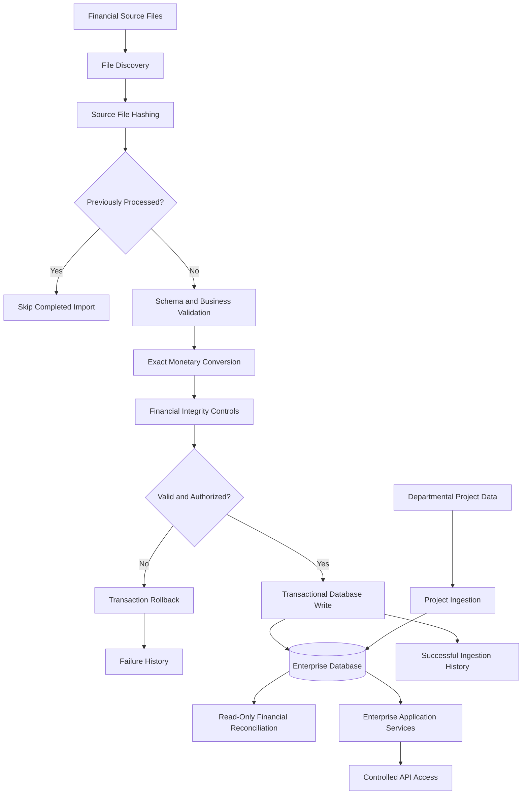
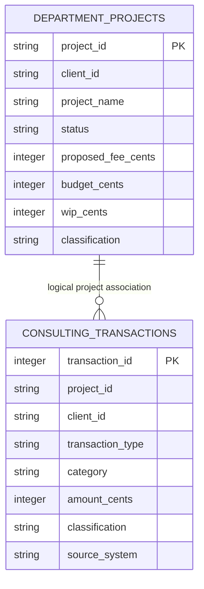
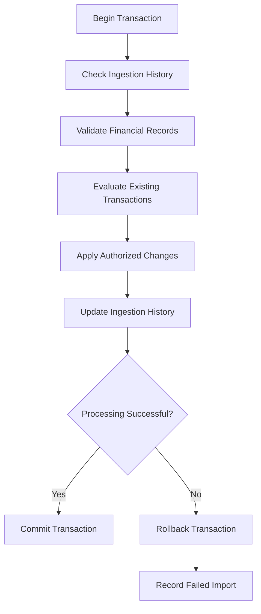
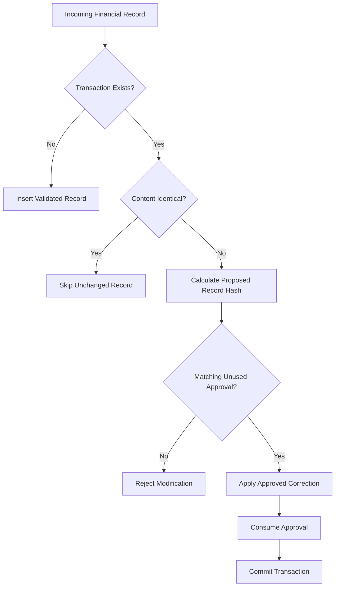
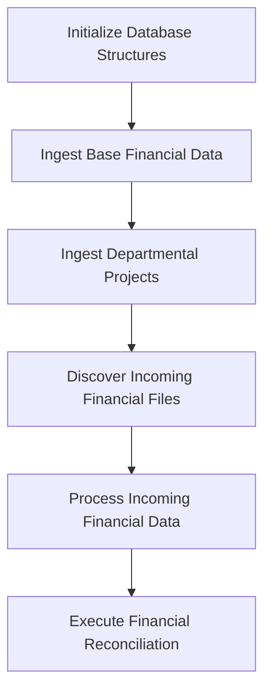

# Data Engineering & Financial Integrity

## 1. Overview

The data engineering component establishes a controlled environment for processing, validating, storing and reconciling enterprise financial information.

The business context represents a fictional consulting organization operating across multiple business units, cost centres, clients and strategic projects.

The objective was to develop a reliable financial data platform that not only processes information efficiently but also protects the accuracy, consistency and integrity of business-critical records.

Particular attention was given to financial precision, repeatable ingestion, transactional consistency, controlled data modification and downstream reporting reliability.

## 2. Engineering Objectives

- Develop structured financial data ingestion pipelines.
- Enforce schema and business-rule validation.
- Prevent duplicate transaction processing.
- Establish repeatable and idempotent ingestion behaviour.
- Eliminate floating-point inaccuracies in monetary calculations.
- Prevent unauthorized modifications to existing financial records.
- Preserve transactional consistency during ingestion failures.
- Support accurate financial reconciliation and enterprise reporting.
- Integrate financial information with departmental project data.
- Establish traceable ingestion and correction processes.

## 3. Data Engineering Architecture

The architecture separates ingestion, validation, financial governance, persistence and reporting into distinct processing responsibilities.

## 4. Pipeline Components

| Component | Responsibility |
|---|---|
| `discover_finance.py` | Discover incoming financial source files |
| `ingest_finance.py` | Financial ingestion and transactional processing |
| `ingest_projects.py` | Departmental project ingestion |
| `validate_finance.py` | Financial schema and business-rule validation |
| `finance_schema.py` | Relational database schema and integrity constraints |
| `money.py` | Exact monetary representation and conversion |
| `migrate_finance.py` | Transactional migration of legacy financial records |
| `reconcile_finance.py` | Read-only financial reconciliation |
| `finance_integrity.py` | Controlled financial corrections and integrity enforcement |
| `enterprise_flow.py` | Workflow orchestration definition |

The modular structure separates processing responsibilities and allows individual components to be tested independently.

## 5. Enterprise Data Model

The financial platform integrates transactional information with departmental project records.

### Financial Transaction Data

| Attribute | Business Purpose |
|---|---|
| Transaction ID | Unique transaction identification |
| Transaction Date | Financial reporting period |
| Business Unit | Organizational attribution |
| Cost Centre | Financial accountability |
| Project ID | Association with enterprise projects |
| Client ID | Client-level attribution |
| Transaction Type | Revenue or expenditure classification |
| Category | Financial activity categorization |
| Description | Transaction context |
| Counterparty ID | Associated financial entity |
| Monetary Amount | Transaction value |
| Classification | Information sensitivity |
| Source System | Data provenance |

### Departmental Project Data

Project records include project identifiers, client associations, project names, commercial status, proposed fees, budgets, work-in-progress values, win probabilities, managerial responsibilities and information classification.

These datasets establish the relationship between operational financial activity and strategic enterprise initiatives.

The diagram presents a simplified logical data model rather than a complete physical database schema.

## 6. Data Ingestion and Idempotency

Financial ingestion is designed to support repeated processing without unintentionally duplicating previously imported information.

Source files are read and hashed using SHA-256. The ingestion history records source identification, processing status, timestamps and error information.

The ingestion process distinguishes between:

- Previously completed source imports.
- New financial transactions.
- Existing transactions with identical content.
- Existing transactions containing modified financial information.
- Invalid or unauthorized transaction records.

Repeated ingestion of an unchanged, successfully processed source file is skipped.

Identical existing transaction records do not require unnecessary modification. Changed records are subject to additional financial integrity controls.

The source file is read once, with hashing and parsing performed against the same content. This reduces inconsistencies between source identification and the data being processed.

## 7. Financial Validation and Data Quality

Financial validation operates before records are accepted into the persistence layer.

| Validation Control | Purpose |
|---|---|
| Transaction identifier validation | Reject invalid identifiers |
| Date validation | Enforce valid financial dates |
| Transaction type validation | Restrict records to supported transaction types |
| Classification validation | Enforce recognized information sensitivity levels |
| Monetary precision validation | Reject unsupported fractional-cent values |
| Non-finite value rejection | Prevent NaN and infinite monetary values |
| Numeric range validation | Prevent unsupported integer storage values |
| Non-zero transaction validation | Reject zero-value financial transactions |
| Negative value validation | Restrict negative amounts to permitted financial categories |

These controls establish explicit data acceptance boundaries rather than relying exclusively on database insertion behaviour.

Invalid records are rejected before they can become part of a successfully committed financial ingestion batch.

## 8. Monetary Precision Engineering

### Identified Problem

The original financial database stored monetary amounts using SQLite REAL values.

Binary floating-point representation can introduce precision inconsistencies when processing decimal financial values. Although these differences may be small at the individual transaction level, they can affect aggregated reporting, reconciliation and financial integrity checks.

### Implemented Solution

The financial persistence model was redesigned to represent monetary amounts as integer cents.

Python Decimal values are used when converting monetary inputs and presenting financial calculations.

| Monetary Value | Integer Storage |
|---:|---:|
| EUR 0.01 | 1 |
| EUR 19.99 | 1,999 |
| EUR 1,250.00 | 125,000 |
| EUR 85,000.00 | 8,500,000 |
| EUR 162,068.00 | 16,206,800 |
| EUR -250.00 | -25,000 |

This approach preserves exact monetary values without depending on binary floating-point arithmetic.

### Monetary Conversion Controls

The conversion implementation addresses:

- Exact conversion between decimal values and integer cents.
- Rejection of fractional-cent values.
- Rejection of non-finite monetary values.
- Signed 64-bit integer storage boundaries.
- Independence from the active decimal arithmetic context.
- Exact reconstruction of monetary values for financial reporting.

Database-level constraints provide an additional control by requiring integer storage for monetary columns.

These constraints complement application validation rather than replacing it.

## 9. Transactional Integrity

Financial ingestion uses explicit SQLite transactions to maintain consistency across multiple processing operations.

An immediate database transaction establishes the write boundary before ingestion history and existing financial records are evaluated.

Successful financial modifications, consumed correction approvals and completed ingestion history are committed together.

If processing fails, database modifications within the transaction are rolled back. Failure information is subsequently recorded separately.

This prevents partially processed financial batches from being treated as successful imports.

## 10. Financial Correction Governance

### Integrity Risk

Financial ingestion systems frequently support updating existing database records. Without appropriate restrictions, this behaviour can allow modified source files to overwrite previously accepted financial information.

Such modifications may originate from legitimate corrections, operational errors or deliberately manipulated data.

### Implemented Control

A financial correction approval mechanism was introduced to distinguish authorized financial corrections from unapproved record modifications.

The correction approval mechanism associates authorization with:

- A specific transaction identifier.
- A cryptographic hash of the proposed replacement record.
- The approving identity.
- An approval timestamp.
- Approval consumption status.

The proposed record hash incorporates canonicalized transaction information, including its monetary value.

An approval therefore applies to a specific proposed modification rather than providing unrestricted permission to overwrite financial records.

Approvals are consumed as part of successful transactional processing, reducing the risk of unauthorized approval reuse.

### Verified Integrity Scenarios

The correction mechanism was evaluated against scenarios involving unauthorized record modification, approved corrections, mismatched proposed record content, approval reuse and transaction rollback.

These controls establish a foundation for financial change governance within automated ingestion processes.

## 11. Database Migration and Schema Evolution

The introduction of exact monetary representation required migrating existing financial records without losing previously stored business information.

The migration converted the legacy REAL-based monetary columns into integer-cent columns.

### Migration Methodology

1. Inspect the existing database schema and stored financial records.
2. Validate database integrity before migration.
3. Evaluate whether existing monetary values can be represented as integer cents.
4. Create an isolated database copy.
5. Execute the schema migration inside a database transaction.
6. Convert existing monetary fields.
7. Compare migrated records against the original information.
8. Validate database integrity and financial reconciliation.
9. Execute the automated regression suite.
10. Apply the validated migration to the operational local database.

### Migration Results

| Verification Metric | Observed Result |
|---|---:|
| Financial transactions migrated | 177 |
| Departmental projects migrated | 5 |
| Monetary values evaluated | 192 |
| Migrated financial schema version | 2 |
| Database integrity check | Passed |
| Financial reconciliation | Passed |
| Full regression suite | 177 passed |

The migration preserved the financial values represented in the existing database. It cannot recover monetary precision that may already have been lost before migration.

## 12. Financial Reconciliation

Financial reconciliation connects departmental project information with the financial transactions associated with each project.

The reconciliation process uses read-only database access and aggregates revenue using integer monetary values before converting the results into Decimal representations.

This preserves monetary precision throughout the reporting process and prevents reconciliation operations from modifying financial records.

### Verified Reconciliation Results

The following results were obtained from the isolated pipeline integration database and independently reproduced inside the final Docker verification container.

| Project | Proposed Fee | Recorded Revenue | Difference |
|---|---:|---:|---:|
| European Market Entry | EUR 85,000.00 | EUR 162,068.00 | EUR 77,068.00 |
| Portfolio Optimisation | EUR 120,000.00 | EUR 152,507.00 | EUR 32,507.00 |
| **Total** | **EUR 205,000.00** | **EUR 314,575.00** | **EUR 109,575.00** |

The numerical differences represent deviations between proposed project fees and recorded revenue. They are not, by themselves, evidence of accounting errors or financial misconduct.

The reconciliation functionality demonstrates the ability to connect financial transactions with enterprise project information while preserving exact monetary values.

## 13. Workflow Orchestration

A Prefect workflow definition was established to coordinate enterprise data processing.

The workflow includes task-level organization, ingestion retry configuration and a daily scheduling definition.

The underlying processing sequence was independently executed against an isolated local database.

The scheduled Prefect service was not started or validated as a continuously operating orchestration environment.

## 14. End-to-End Data Integration

A dedicated integration workspace was created to evaluate the interaction between the financial pipelines, database schema, departmental project ingestion and reconciliation functionality.

### Integration Results

| Processing Stage | Observed Result |
|---|---:|
| Base financial transactions ingested | 174 |
| Additional financial transactions ingested | 1 |
| Total financial transactions | 175 |
| Departmental projects ingested | 5 |
| Completed financial source imports | 2 |
| Duplicate records introduced during replay | 0 |
| Database integrity check | Passed |
| Financial reconciliation | Passed |

The source files were subsequently reprocessed to verify repeatable ingestion behaviour.

Previously completed financial imports were skipped, and existing departmental project records were not duplicated.

The intentionally invalid financial fixture was excluded from the successful integration sequence and evaluated through separate failure-handling tests.

The isolated integration database contains 175 transactions, while the migrated operational database contains 177 transactions. These represent distinct processing scenarios and database histories.

## 15. Testing and Verification

The data engineering components were evaluated through automated testing, isolated integration workflows, database inspection and containerized financial processing.

| Verification Area | Result |
|---|---|
| Monetary conversion | Passed |
| Financial business-rule validation | Passed |
| Database monetary constraints | Passed |
| Duplicate transaction prevention | Passed |
| Source file replay handling | Passed |
| Unauthorized financial correction rejection | Passed |
| Authorized financial correction processing | Passed |
| Transaction rollback behaviour | Passed |
| Financial database migration | Passed |
| Read-only reconciliation | Passed |
| Isolated pipeline integration | Passed |
| Containerized reconciliation | Passed |
| Full automated regression suite | 177 passed, 0 failed |

The final regression suite completed in 1.64 seconds with one non-blocking dependency deprecation warning.

The reported 177 tests cover the entire enterprise platform, including its data engineering, application architecture and security components.

## 16. Engineering Decisions and Trade-offs

| Design Decision | Engineering Benefit | Limitation |
|---|---|---|
| Integer-cent monetary storage | Exact financial representation | Requires explicit conversion |
| SQLite relational storage | Lightweight and reproducible local processing | Limited high-concurrency scalability |
| SHA-256 source hashing | Reliable source content identification | Does not establish source authenticity |
| Transactional batch ingestion | Prevents partial successful imports | Longer transactions may increase write contention |
| Record-specific correction approvals | Restricts unauthorized financial changes | Requires an approval management process |
| Read-only reconciliation | Reduces reporting-related modification risks | Reporting cannot directly correct discrepancies |
| Modular processing pipelines | Improves maintainability and testability | Requires coordination between components |
| Workflow orchestration definition | Establishes repeatable execution sequencing | Continuous scheduling remains unverified |

## 17. Known Limitations

The platform was developed as a controlled enterprise engineering demonstrator.

The following capabilities remain outside its completed implementation or verification scope:

- Distributed and high-volume financial data processing.
- Real-time streaming ingestion.
- Production-grade financial approval workflows.
- Cryptographic source authentication.
- Continuous orchestration monitoring and alerting.
- Enterprise data warehouse integration.
- Comprehensive regulatory and accounting compliance validation.

Source files are processed in memory, which limits suitability for substantially larger datasets. Database contention and extreme aggregate monetary overflow also require further evaluation before production deployment.

## 18. Engineering Outcomes

The completed data engineering component demonstrates capabilities across financial data processing, relational data modelling, transactional database operations, data quality management, financial governance and operational reporting.

The platform addresses not only how enterprise information is collected and processed, but also how its integrity can be preserved throughout ingestion, storage, modification and consumption.

Its principal engineering outcome is the integration of reliable financial processing with explicit data governance and security controls within a wider enterprise application architecture.

---

[Return to Project Overview](../README.md) | [Enterprise Architecture](architecture.md) | [Infrastructure Engineering](infrastructure.md)
