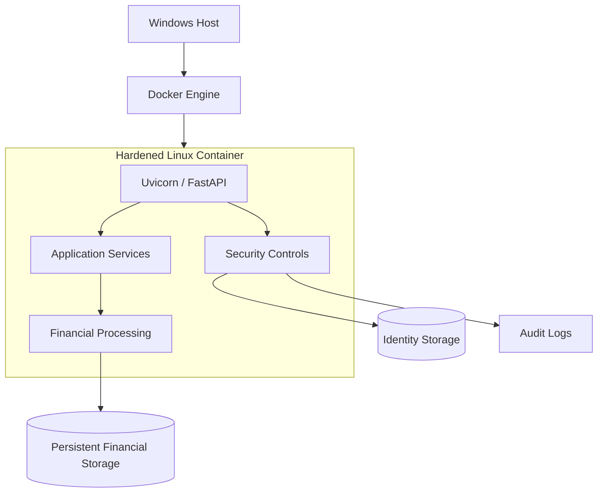

# Infrastructure Engineering & Containerization

## 1. Overview

I wanted to establish a containerized environment for the enterprise platform without treating infrastructure security as an afterthought.

The main objective was to isolate the application runtime, restrict its privileges, protect financial data and ensure that the application remained functional under these restrictions.

The environment was developed locally using Windows, PowerShell, Docker Desktop and Linux-based containers.

## 2. Infrastructure Design

The application runs as a containerized FastAPI service using Uvicorn, with SQLite providing persistent relational storage.

Application code and persistent data are separated so that rebuilding or replacing the container does not inherently require replacing the underlying database.



The diagram represents the logical deployment architecture. The final isolated runtime test focused on read-only financial processing rather than writable identity and audit services.

### Infrastructure configuration

| File | Purpose |
|---|---|
| `Dockerfile` | Base application image |
| `Dockerfile.offline` | Application updates using an existing local image |
| `compose.yaml` | Declarative infrastructure configuration |
| `.dockerignore` | Exclusion of unnecessary and sensitive build artifacts |
| `.gitignore` | Exclusion of local databases, logs and development artifacts |

## 3. Container Hardening

Once the application was containerized, the next priority was reducing its execution privileges and limiting unnecessary access to the host environment.

The final verification container used the following configuration:

| Control | Configuration |
|---|---|
| Application user | Non-root (`appuser`) |
| User ID | 10001 |
| Network | `none` |
| Root filesystem | Read-only |
| Linux capabilities | All dropped |
| Privilege escalation | No new privileges |
| Temporary storage | `/tmp` mounted as tmpfs |
| Financial database mount | Read-only |
| Published host ports | None |

The rationale was to establish the minimum execution permissions necessary for the tested application functionality.

### Runtime verification

I inspected the effective process privileges in an earlier verification container to establish whether the configured restrictions were actually being enforced.

Relevant observations from `/proc/1/status`:

```text
Uid:        10001   10001   10001   10001
Gid:        10001   10001   10001   10001
CapPrm:     0000000000000000
CapEff:     0000000000000000
CapBnd:     0000000000000000
NoNewPrivs: 1
```

Controlled write attempts were also performed against the application directory and mounted financial storage. Both were rejected with read-only filesystem errors (`Errno 30`).

These checks confirmed that the tested privilege and filesystem restrictions were enforced at runtime.

## 4. Persistent Storage and Permission Troubleshooting

One of the more interesting infrastructure issues occurred during persistent storage testing.

A dedicated Docker volume was created to establish whether financial records could survive container replacement. However, the application initially failed to create a SQLite database inside the volume.

The error indicated that the database could not be opened.

Inspecting the volume permissions revealed the underlying issue:

| Attribute | Value |
|---|---|
| Volume directory owner | UID 0 (root) |
| Volume directory group | GID 0 (root) |
| Directory permissions | 0755 |
| Application user | UID 10001 |

The non-root application process did not have sufficient write permissions.

Running the application as root would have resolved the immediate error but undermined the existing security configuration.

Instead, I used a temporary maintenance container to change ownership of the dedicated test volume. The maintenance process was granted the capability required for the ownership change:

```text
--user 0:0
--cap-drop ALL
--cap-add CHOWN
```

Ownership of the volume directory was changed to `10001:10001`.

The application subsequently initialized the database successfully while retaining non-root execution.

### Persistence verification

A fictional financial record was inserted into the test database. The original container was terminated, and the record was retrieved from a separate container using the same volume.

Retrieved record:

```text
(1, 125000)
```

The stored monetary value represents EUR 1,250.00 in integer cents.

This confirmed that the committed record persisted independently of the original container instance.

The exercise also demonstrated why storage permissions need to be considered alongside container security. Restricting execution privileges is only useful if the application can still perform its intended operations.

## 5. Offline Image Builds

As the application evolved, I needed to incorporate updated financial pipelines, architectural components and AI security modules into the existing container image.

Rather than reinstalling dependencies for every application update, I created a separate offline Dockerfile that reused the locally available application image.

```dockerfile
FROM enterprise-api-security-testing-api:latest

COPY main.py config.py ./
COPY pipelines/ ./pipelines/
COPY security/ ./security/
COPY app/ ./app/
COPY ai_security/ ./ai_security/
```

The final image was built using:

```powershell
docker build --network none --pull=false -f Dockerfile.offline -t enterprise-api-security-testing-api:offline-final .
```

Final build output (excerpt):

```text
[+] Building 0.7s (11/11) FINISHED

CACHED [1/6] FROM docker.io/library/enterprise-api-security-testing-api:latest
[2/6] COPY main.py config.py ./
[3/6] COPY pipelines/ ./pipelines/
[4/6] COPY security/ ./security/
[5/6] COPY app/ ./app/
[6/6] COPY ai_security/ ./ai_security/
```

All build operations completed successfully, with a build context of 45.25 kB.

The Docker build context excluded local databases, virtual environments, logs, source datasets, backups and isolated verification workspaces.

The offline build depends on an existing local base image. It is therefore suitable for controlled application updates but does not provide a complete offline installation from an empty environment.

The build flags also do not independently guarantee that Docker itself cannot attempt registry communication. Physical network disconnection was used as an additional precaution during earlier offline build verification.

## 6. Application Health and Dependency Verification

A running container does not necessarily mean that the application is operational.

To test this distinction, I evaluated the application's health endpoint with and without its required financial database.

| Test condition | HTTP response |
|---|---:|
| Application running without database | 503 |
| Application running with readable database | 200 |

The health endpoint checks database accessibility using a read-only connection.

This allows the application to distinguish successful server startup from basic database readiness.

The check does not validate every database table, identity service or application operation.

## 7. Final Container Verification

Following the financial database migration and application updates, I started the final verification container using the isolated integration database.

```powershell
docker run -d `
  --name enterprise-final-verification `
  --pull=never `
  --network none `
  --read-only `
  --cap-drop ALL `
  --security-opt no-new-privileges:true `
  --tmpfs /tmp `
  --mount "type=bind,source=$($PWD.Path)\integration-work,target=/app-data,readonly" `
  --env ENTERPRISE_DATA_DIR=/app-data `
  enterprise-api-security-testing-api:offline-final
```

The intention was to determine whether the updated application and financial reconciliation functionality remained operational under restrictive infrastructure conditions.

### Application startup

```text
INFO:     Started server process [1]
INFO:     Waiting for application startup.
INFO:     Application startup complete.
INFO:     Uvicorn running on http://0.0.0.0:8000
```

The health endpoint was accessed from within the container using its internal loopback interface.

```text
HTTP status: 200
{"status":"healthy","service":"enterprise-api-security-testing"}
```

No host ports were published.

### Security configuration

The running container was inspected using `docker inspect`.

Relevant output:

```text
User=appuser
Network=none
ReadOnly=true
CapDrop=[ALL]
SecurityOpt=[no-new-privileges:true]
```

Inspection also confirmed that the mounted database directory was not writable (`RW=false`).

### Financial reconciliation

The reconciliation module was executed directly inside the isolated container.

```text
('STR-2026-001', 'European Market Entry', Decimal('85000.00'), Decimal('162068.00'))
('STR-2026-002', 'Portfolio Optimisation', Decimal('120000.00'), Decimal('152507.00'))

PASS: Containerized financial reconciliation verified
```

These results matched the reconciliation previously performed outside the container.

The application therefore retained the tested financial reporting functionality without requiring external networking, elevated privileges or writable financial storage.

## 8. Verification and Engineering Evidence

| Verification | Result |
|---|---|
| Offline image build | Passed |
| Application module imports | Passed |
| Non-root execution | Verified |
| Linux capability restrictions | Verified |
| Privilege escalation restrictions | Verified |
| Network isolation configuration | Verified |
| Root filesystem write protection | Passed |
| Mounted storage write protection | Passed |
| Persistent volume permission remediation | Passed |
| Cross-container data persistence | Passed |
| Missing database health response | HTTP 503 |
| Final application health response | HTTP 200 |
| Containerized financial reconciliation | Passed |

Following the infrastructure changes, the complete application regression suite was executed against an isolated database workspace.

```text
177 passed, 1 warning in 1.64s
```

The warning concerns a dependency deprecation. No tests failed.

The 177 tests cover the entire application platform, rather than infrastructure alone.

### Selected Git checkpoints

| Commit | Description |
|---|---|
| `154fe54` | Add offline Docker build for secure enterprise API |
| `be4a69b` | Finalize hardened offline enterprise application container |

Additional supporting material is organized in the [engineering evidence directory](../evidence/).

## 9. Limitations and Lessons Learned

The project demonstrates a hardened local application environment rather than production-grade hosting infrastructure.

Several limitations remain:

- Authenticated API operations were not verified inside the final read-only container.
- Network isolation was evaluated through configuration inspection rather than independent packet monitoring.
- The offline build requires a previously available local base image.
- Persistent storage testing covered a controlled database record rather than complete application recovery.
- Production monitoring, vulnerability scanning, high availability and distributed orchestration were outside the project scope.

The main lesson from this component was that infrastructure hardening involves balancing security restrictions with operational requirements.

The persistent storage permission issue was a practical example of this. The appropriate solution was not to remove security restrictions, but to identify the specific permission required and address it without unnecessarily expanding the application's privileges.

---

[Project Overview](../README.md) | [Architecture](architecture.md) | [Data Engineering](data-engineering.md) | [Cybersecurity](cybersecurity.md)
