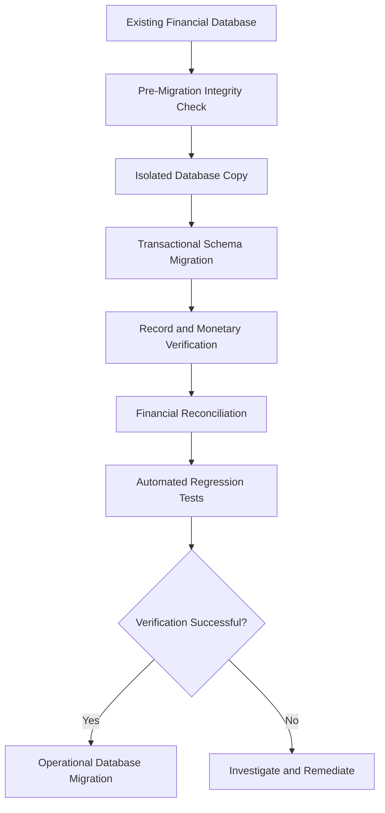
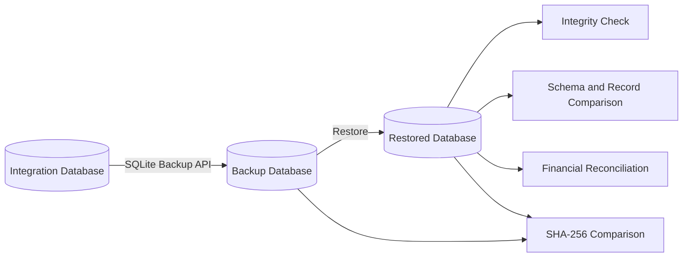

# Systems Reliability & Database Recovery

## 1. Overview

An important consideration when developing the enterprise platform was how to introduce changes without compromising existing financial records or creating unnecessary operational risks.

I focused on three areas of reliability:

- Safe database schema evolution.
- Repeatable financial data processing.
- Database backup, restoration and integrity verification.

All recovery exercises were conducted locally using fictional enterprise data and isolated verification environments.

## 2. Database Migration and Regression Testing

During development, I identified a limitation in the original financial database schema. Monetary values were stored using SQLite REAL columns, which introduced unnecessary floating-point precision risks.

To address this, the financial schema was redesigned to store monetary values as integer cents.

However, changing the schema also introduced compatibility issues between existing databases and updated application components.

An initial regression test identified three failures associated with outdated database columns:

```text
no such column: p.proposed_fee_cents
```

This highlighted the need for a controlled migration process rather than simply replacing the database schema or recreating the underlying data.

### Migration approach



Before applying the migration to the operational database, I tested the process against an isolated copy.

The migration was implemented within a database transaction, allowing schema changes and financial record conversion to be committed together.

### Migration verification

| Verification | Result |
|---|---:|
| Financial transactions retained | 177 |
| Departmental projects retained | 5 |
| Monetary values evaluated | 192 |
| Original schema version | 0 |
| Migrated schema version | 2 |
| Database integrity check | Passed |
| Financial reconciliation | Passed |
| Automated regression tests | 177 passed |

The migration preserved the monetary values represented in the existing database without introducing additional rounding.

Following successful isolated verification, the migration was applied to the operational local database.

## 3. Repeatable Data Processing

Financial ingestion needs to remain reliable when source files are processed more than once.

To evaluate this behaviour, I executed the financial processing sequence against a separate integration database and subsequently replayed the same source files.

The ingestion mechanism uses source file hashing, ingestion history and transaction-level integrity controls to identify previously processed information.

| Metric | Initial Processing | After Replay |
|---|---:|---:|
| Financial transactions | 175 | 175 |
| Departmental projects | 5 | 5 |
| Completed financial imports | 2 | 2 |
| Duplicate records introduced | 0 | 0 |

The replay did not introduce additional transactions or departmental project records.

### Failure handling

Separate automated tests evaluated invalid financial records, unauthorized corrections and transactional rollback behaviour.

The objective was to ensure that a failed ingestion operation could not leave partially committed financial changes or incorrectly mark an unsuccessful import as completed.

The targeted ingestion and reconciliation test suite returned:

```text
7 passed
```

These tests form part of the complete platform regression suite.

## 4. Database Backup and Recovery

I created a dedicated recovery workspace to establish whether the integrated financial database could be backed up and restored without losing its schema, records or reporting functionality.

Rather than relying exclusively on a filesystem copy, the backup process used SQLite's native backup functionality.

The original integration database was retained throughout the exercise.



### Recovery verification methodology

The verification process included:

1. Creating a consistent backup of the integration database.
2. Restoring the backup into a separate database file.
3. Running SQLite integrity checks.
4. Comparing the original and restored logical database contents.
5. Executing financial reconciliation against the restored database.
6. Comparing SHA-256 hashes of the backup and restored files.

The recovery exercise did not involve deleting or modifying the original database.

## 5. Recovery Results

### Database integrity

SQLite database integrity was evaluated using:

```sql
PRAGMA integrity_check;
```

Both the backup and restored database returned:

```text
ok
```

A logical database comparison using SQLite's `iterdump()` functionality also confirmed equivalence between the original integration database and restored database.

### File integrity

The backup and restored database files produced identical SHA-256 hashes:

```text
CF577727F66D5D78FF2310BD813402E60C710895743BD05C7008A8CF5573CFAE
```

The matching hashes confirmed byte-level equivalence between the two files at the time of verification.

The hash comparison complements the logical database comparison and integrity checks. It does not independently establish the authenticity of a database or protect it against subsequent modification.

### Financial reconciliation after recovery

Database restoration is only useful if the recovered information remains operationally meaningful.

To verify this, I executed the financial reconciliation module against the restored database.

| Project | Proposed Fee | Recorded Revenue |
|---|---:|---:|
| European Market Entry | EUR 85,000.00 | EUR 162,068.00 |
| Portfolio Optimisation | EUR 120,000.00 | EUR 152,507.00 |
| **Total** | **EUR 205,000.00** | **EUR 314,575.00** |

The results matched those obtained from the original integration database.

This established that the restored database retained both the underlying financial records and the information required by the tested reporting functionality.

## 6. Supporting Reliability Controls

Several other application and infrastructure controls contribute to operational reliability.

| Control | Purpose |
|---|---|
| Transactional ingestion | Prevent partially committed financial batches |
| Source file hashing | Identify previously processed source content |
| Financial correction approvals | Restrict unauthorized transaction modifications |
| Integer monetary storage | Preserve exact financial values |
| Read-only reconciliation | Prevent reporting operations from modifying financial records |
| Persistent Docker storage | Preserve committed data across container lifecycles |
| Dependency-aware health endpoint | Identify unavailable financial storage |
| Automated regression testing | Detect unintended changes in application behaviour |

The infrastructure verification also demonstrated that the health endpoint returned HTTP 503 when the financial database was unavailable and HTTP 200 when readable storage was provided.

Further details are available in the [infrastructure documentation](infrastructure.md).

## 7. Final Verification

Following the database migration, financial integrity improvements and containerization changes, the complete automated regression suite was executed against an isolated database workspace.

```text
177 passed, 1 warning in 1.64s
```

No tests failed. The remaining warning relates to dependency deprecation.

### Reliability verification summary

| Verification | Result |
|---|---|
| Transactional schema migration | Passed |
| Financial record preservation | Passed |
| Repeatable source ingestion | Passed |
| Invalid ingestion failure handling | Passed |
| Database backup | Passed |
| Database restoration | Passed |
| SQLite integrity verification | Passed |
| Logical database equivalence | Passed |
| Backup and restoration hash equivalence | Passed |
| Post-recovery financial reconciliation | Passed |
| Cross-container data persistence | Passed |
| Full platform regression suite | Passed |

### Relevant Git checkpoints

| Commit | Description |
|---|---|
| `f527527` | Enforce read-only SQLite access for financial reconciliation |
| `5b4422d` | Enforce exact monetary precision and financial integrity controls |
| `60967e0` | Complete transactional financial schema migration and integration |
| `be4a69b` | Finalize hardened offline enterprise application container |

Supporting verification material is organized in the [engineering evidence directory](../evidence/).

## 8. Limitations and Lessons Learned

The recovery exercise verified the financial database rather than the entire enterprise infrastructure.

The following areas remain outside the completed verification scope:

- Automated backup scheduling and retention policies.
- Off-site and geographically redundant backups.
- Identity database and audit log recovery.
- Point-in-time recovery.
- Recovery time and recovery point objective measurement.
- High-availability infrastructure and automatic failover.
- Recovery from an actual infrastructure failure.

The transactional migration was successfully tested, although a deliberately induced migration failure was not evaluated separately.

One of the main lessons from this project was that successful data recovery should be evaluated at multiple levels. A readable database file alone does not demonstrate that its records, schema and dependent business processes remain intact.

Combining database integrity checks, content comparisons, cryptographic hashes and financial reconciliation provided a stronger basis for evaluating recovery success within the defined project scope.

---

[Project Overview](../README.md) | [Data Engineering](data-engineering.md) | [Infrastructure](infrastructure.md) | [Testing](testing.md)
