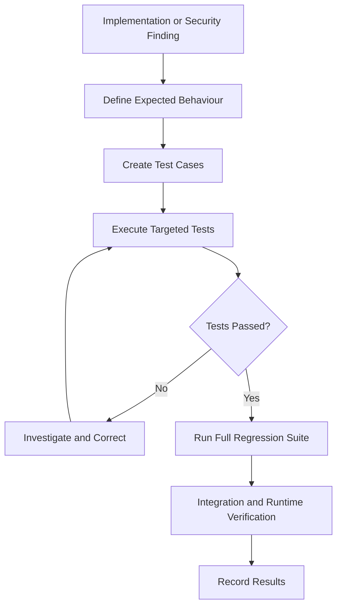

# Testing & Engineering Verification

## 1. Overview

Throughout development, I used automated regression testing alongside manual application, database and infrastructure verification.

The objective was to ensure that introducing new security controls, architectural changes and financial processing functionality did not compromise existing application behaviour.

Testing was performed locally using fictional enterprise data, temporary databases and isolated container environments.

### Final regression result

| Metric | Result |
|---|---:|
| Tests passed | 177 |
| Tests failed | 0 |
| Warnings | 1 |
| Execution time | 1.64 seconds |

The execution time represents the recorded local test run rather than a formal application performance benchmark.

## 2. Testing Methodology

I used several complementary testing approaches throughout the project.

| Testing Method | Purpose |
|---|---|
| Unit testing | Verify individual functions, domain objects and security policies |
| Parameterized testing | Evaluate multiple inputs and boundary conditions |
| API testing | Verify endpoint behaviour and authorization decisions |
| Integration testing | Evaluate interactions between application and database components |
| Negative testing | Confirm rejection of invalid or unauthorized operations |
| Regression testing | Detect unintended changes after implementation updates |
| Security testing | Reproduce vulnerabilities and verify remediation |
| Infrastructure testing | Verify container configuration and runtime restrictions |
| Recovery testing | Establish database restoration and integrity |

The primary automated testing framework was pytest, with FastAPI TestClient used for in-process HTTP requests.

SQLite database queries, PowerShell commands and Docker inspection were used for additional verification outside the automated test suite.

### Testing workflow



I generally tested individual components before executing the complete regression suite. This made it easier to identify the source of failures when introducing larger architectural changes.

## 3. Test Organization

The test files are organized around the application's functional and security components.

| Test File | Primary Coverage |
|---|---|
| `test_main.py` | Core API endpoints and response behaviour |
| `test_access_policy.py` | Role-based and resource-based authorization |
| `test_identity.py` | Identity management and credential lifecycle |
| `test_audit_log.py` | Security event recording |
| `test_finance.py` | Financial transaction validation |
| `test_money.py` | Exact monetary conversion and boundary conditions |
| `test_finance_schema.py` | Database monetary integrity constraints |
| `test_ingestion.py` | Financial ingestion, corrections and rollback |
| `test_reconciliation.py` | Financial reconciliation |
| `test_project_domain.py` | Project domain models and business rules |
| `test_project_architecture.py` | Architectural boundaries and application components |
| `test_projects_api.py` | Project API behaviour and authorization |
| `security/test_finance_integrity.py` | Financial correction approval controls |
| `ai_security/test_agent_security.py` | Simulated AI-agent security scenarios |

The tests cover both successful operations and conditions under which the application is expected to reject a request or transaction.

## 4. Test Environment Isolation

Some tests intentionally modify credentials, financial records or security approval states.

Running these tests directly against the operational database would introduce unnecessary risks and make the results dependent on existing application state.

To address this, I used temporary SQLite databases, pytest fixtures and monkeypatching.

### Identity testing example

```python
@pytest.fixture(autouse=True)
def isolated_identity_database(tmp_path, monkeypatch):
    database_path = tmp_path / "test_identity.db"

    monkeypatch.setattr(
        identity_module,
        "IDENTITY_DATABASE_PATH",
        database_path,
    )

    initialize_identity_registry()
```

This fixture redirects the identity registry to a temporary database and initializes fictional identities for each test.

It allows credential rotation, account disabling and revocation to be tested without intentionally modifying operational identities.

### Isolated verification workspaces

Separate local workspaces were also used for broader engineering verification.

| Workspace | Purpose |
|---|---|
| `migration-work/` | Schema migration and regression testing |
| `integration-work/` | Financial pipeline integration and replay testing |
| `recovery-work/` | Database backup and restoration |
| Docker test volume | Persistent storage verification |

The application supports configurable database locations through the `ENTERPRISE_DATA_DIR` environment variable.

Operational databases, temporary verification workspaces and generated audit logs are excluded from the published repository.

## 5. Selected Test Scenarios

### API security and authorization

The API assessment included positive and negative authorization scenarios.

| Scenario | Expected Behaviour | Result |
|---|---|---|
| Missing credential | HTTP 401 | Passed |
| Invalid credential | HTTP 401 | Passed |
| Unauthorized Finance document access | HTTP 403 | Passed |
| Authorized document access | HTTP 200 | Passed |
| Malformed document identifier | HTTP 422 | Passed |
| Revoked credential | Authentication rejected | Passed |
| Expired credential | Authentication rejected | Passed |
| Disabled AI identity | Access rejected | Passed |
| Credential rotation | Previous credential rejected | Passed |

Several authorization scenarios were implemented as parameterized tests to evaluate different combinations of identities, resources and expected responses.

### Financial validation and monetary precision

Financial processing tests evaluated both valid transactions and invalid monetary inputs.

| Scenario | Expected Behaviour | Result |
|---|---|---|
| Valid financial amount | Accepted | Passed |
| Missing required field | Rejected | Passed |
| Invalid transaction date | Rejected | Passed |
| Unknown security classification | Rejected | Passed |
| Approved negative financial adjustment | Accepted | Passed |
| Unauthorized negative adjustment | Rejected | Passed |
| Fractional cent amount | Rejected | Passed |
| Non-finite monetary value | Rejected | Passed |
| Integer overflow | Rejected | Passed |
| Exact monetary conversion | Preserved | Passed |

Monetary conversion was tested independently from database storage to distinguish conversion errors from database-level integrity problems.

### Financial ingestion and correction security

| Scenario | Expected Behaviour | Result |
|---|---|---|
| Valid new transaction | Inserted | Passed |
| Identical transaction | Left unchanged | Passed |
| Unauthorized correction | Rejected | Passed |
| Approved correction | Applied | Passed |
| Manipulated approved content | Rejected | Passed |
| Previously consumed approval | Rejected | Passed |
| Invalid transaction batch | Rolled back | Passed |
| Failed import | Failure recorded | Passed |
| Approval consumption during failed import | Rolled back | Passed |

These tests verify not only whether an operation fails, but also whether the underlying financial records and approval states remain consistent after failure.

### AI-agent security

The AI security tests use deterministic attack simulations rather than an external language model.

| Scenario | Expected Behaviour | Result |
|---|---|---|
| Simulated unauthorized document request | HTTP 403 | Passed |
| Benign content | No simulated malicious tool call | Passed |
| Prohibited simulated data transfer | Denied by policy | Passed |
| Destination and classification policy cases | Correct allow or deny decision | Passed |

Additional standalone checks evaluated missing classifications, unknown destinations and destination spoofing.

No actual external data transfer was performed.

## 6. Regression Testing and Defect Investigation

Two cases were particularly useful in demonstrating why targeted tests and full regression tests serve different purposes.

### Case 1: Financial data poisoning

The original financial ingestion implementation allowed an existing transaction to be overwritten by manipulated source data.

The initial security test reproduced the vulnerability:

```text
SEC-BIZ-001 original amount: EUR 12500.0
SEC-BIZ-001 modified amount: EUR 1.0
```

At this stage, the test passed because the vulnerable behaviour had been successfully reproduced.

After implementing record-specific financial correction approvals, the test was changed to verify that:

- The unauthorized correction was rejected.
- The original financial value remained unchanged.
- The failed ingestion was recorded appropriately.

| Verification | Before Remediation | After Remediation |
|---|---|---|
| Original amount | EUR 12,500 | EUR 12,500 |
| Manipulated amount | EUR 1 | EUR 1 |
| Unauthorized update | Accepted | Rejected |
| Final stored amount | EUR 1 | EUR 12,500 |

This established a repeatable regression test for the original vulnerability.

Further details are available in the [cybersecurity assessment](cybersecurity.md).

### Case 2: Financial schema compatibility

During the transition from floating-point monetary storage to integer cents, I executed a targeted regression suite covering financial processing, monetary conversion, schema constraints and application architecture.

The targeted tests returned:

```text
70 passed in 0.63s
```

However, the subsequent full regression suite identified three failures.

The underlying database error was:

```text
no such column: p.proposed_fee_cents
```

The affected functionality included:

- Authorized financial access and audit logging.
- API credential rotation verification.
- Financial reporting.

The updated application expected the new integer-based schema, while the existing operational database still contained the original monetary columns.

Rather than removing the affected tests or recreating the database, I implemented a transactional schema migration and verified it against an isolated copy.

Following migration, the complete regression suite returned:

```text
177 passed, 1 warning in 1.64s
```

This was an important example of a change that passed component-level testing but exposed a compatibility issue during broader application verification.

Further details are available in the [reliability documentation](reliability.md).

## 7. Integration and Infrastructure Verification

Some engineering outcomes were verified separately from pytest because they involved actual container execution, persistent storage or database recovery.

### Financial pipeline integration

The financial processing sequence was executed against an isolated integration database.

| Verification | Result |
|---|---:|
| Financial transactions imported | 175 |
| Departmental projects imported | 5 |
| Completed financial imports | 2 |
| Duplicate transactions introduced during replay | 0 |
| Database integrity check | Passed |
| Financial reconciliation | Passed |

The pipeline functions were executed directly. The live Prefect scheduler was not part of this verification.

### Database migration and recovery

| Verification | Result |
|---|---|
| Transactional schema migration | Passed |
| Preservation of 177 financial transactions | Passed |
| Preservation of 5 departmental projects | Passed |
| Verification of 192 monetary values | Passed |
| Database backup and restoration | Passed |
| Logical database content comparison | Passed |
| Backup and restored file hash comparison | Passed |
| Post-recovery financial reconciliation | Passed |

The migration and recovery exercises used different isolated databases from the pipeline integration tests.

### Container runtime verification

| Verification | Result |
|---|---|
| Offline application image build | Passed |
| Application module imports | Passed |
| Non-root application execution | Verified |
| Linux capability restrictions | Verified |
| Privilege escalation protection | Verified |
| Network isolation configuration | Verified |
| Application filesystem write protection | Passed |
| Mounted storage write protection | Passed |
| Persistent storage permission remediation | Passed |
| Cross-container data persistence | Passed |
| Missing database health response | HTTP 503 |
| Available database health response | HTTP 200 |
| Final containerized financial reconciliation | Passed |

These infrastructure and recovery checks are separate from the 177 automated tests and are not included in that count.

## 8. Final Regression Results

### Combined security regression

The final targeted security regression included the following test groups.

| Test Group | Tests Passed |
|---|---:|
| Identity and credential management | 17 |
| Access policy and project API | 30 |
| Security audit logging | 3 |
| Simulated AI-agent security | 4 |
| **Total** | **54** |

Observed output:

```text
54 passed, 1 warning in 1.04s
```

### Financial and architectural regression

| Test Group | Tests Passed |
|---|---:|
| Monetary conversion | 33 |
| Financial schema | 13 |
| Financial integrity | 12 |
| Financial ingestion | 6 |
| Financial reconciliation | 1 |
| Application architecture | 5 |
| **Total** | **70** |

Observed output:

```text
70 passed in 0.63s
```

### Complete platform regression

The final regression suite was executed following the financial schema migration, security integration and hardened container verification.

Observed output:

```text
177 passed, 1 warning in 1.64s
```

The remaining warning was a Starlette TestClient dependency deprecation concerning the use of `httpx`.

The regression suites containing 54 and 70 tests represent targeted subsets of the complete platform suite. Their results are not added to the final count of 177 tests.

### Selected development checkpoints

| Development Stage | Tests Passed |
|---|---:|
| Application and financial security regression | 100 |
| Final integrated platform regression | 177 |

Additional tests were introduced as the application architecture, financial integrity controls and infrastructure-related functionality evolved.

## 9. Reproducing the Tests

The following commands document the testing approach used during development.

They assume that the local Python environment, required dependencies and appropriate fictional test databases have already been prepared.

Tests should be executed against a disposable or isolated workspace rather than a database containing operational information.

### Complete regression suite

```powershell
python -m pytest -q
```

### Security regression

```powershell
python -m pytest ai_security/test_agent_security.py test_access_policy.py test_identity.py test_projects_api.py test_audit_log.py -q
```

### Financial and architecture regression

```powershell
python -m pytest test_ingestion.py test_reconciliation.py test_project_architecture.py test_money.py test_finance_schema.py security/test_finance_integrity.py -q
```

### Financial data poisoning regression

```powershell
python -m pytest test_ingestion.py::test_security_financial_data_poisoning -v
```

The automated API tests use in-process application requests. No external target or third-party service is required by the documented security scenarios.

## 10. Limitations and Lessons Learned

The test results establish application behaviour within the defined local verification scope.

They do not demonstrate complete production readiness or exhaustive security coverage.

The following areas were not formally evaluated:

- Source-code coverage percentages.
- Performance benchmarking and concurrent workload testing.
- Large-scale financial dataset processing.
- Automated CI/CD test execution.
- Live workflow scheduler operation.
- Full authenticated API functionality inside the final hardened container.
- Deliberately induced schema migration failure.
- Complete infrastructure disaster recovery.
- Live language model security testing.
- External penetration testing.

The most important lesson from the testing process was that passing individual component tests does not necessarily establish system-wide correctness.

The schema compatibility failure demonstrated the importance of testing existing application functionality after database changes. The financial data poisoning scenario also demonstrated that security testing should examine legitimate application behaviour, not just malformed or unauthorized API requests.

Combining automated regression tests with direct database inspection, controlled vulnerability reproduction, container verification and recovery exercises provided a broader understanding of the system's behaviour.

Supporting material is organized in the [engineering evidence directory](../evidence/).

---

[Project Overview](../README.md) | [Architecture](architecture.md) | [Data Engineering](data-engineering.md) | [Cybersecurity](cybersecurity.md) | [AI Security](ai-security.md) | [Reliability](reliability.md)
