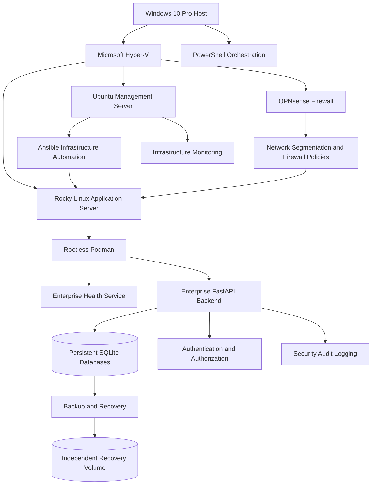

# Secure Enterprise Network & Private Cloud Infrastructure

An infrastructure and cybersecurity engineering project combining network segmentation, virtualization, Linux administration, infrastructure automation, secure containerization, enterprise backend integration, operational monitoring and disaster recovery within a controlled local environment.


## Project Overview

Enterprise infrastructure must balance operational reliability, secure connectivity, application accessibility and centralized administration while maintaining clear security boundaries.

This project explores how these requirements can be addressed through a locally hosted enterprise infrastructure platform using Microsoft Hyper-V, OPNsense, Ubuntu Server, Rocky Linux and rootless Podman.

Rather than treating networking, infrastructure automation, container security and operational resilience as separate disciplines, the implementation integrates them into a functioning environment with controlled communication, reproducible application deployment, persistent enterprise data, security validation and independent disaster recovery.

The infrastructure uses fictional enterprise data and locally controlled resources. No external cloud infrastructure is required for its operation.

## Engineering Objectives

- Design and deploy a segmented enterprise network using private virtual infrastructure.
- Establish centralized infrastructure administration through secure SSH access.
- Implement Linux operating system hardening and restrictive firewall policies.
- Automate infrastructure configuration and application deployment using Ansible.
- Build, transfer and deploy container images using offline engineering workflows.
- Enforce least-privilege execution and network isolation for containerized applications.
- Integrate an enterprise backend with persistent data and role-based authorization.
- Implement controlled application upgrades, rollback and recovery.
- Develop backup and independent restoration procedures.
- Implement health monitoring and centralized operational administration.
- Validate infrastructure security, application functionality and operational reliability through repeatable testing.

## System Architecture

The laboratory separates network security, infrastructure management and application hosting responsibilities across three virtual machines.



### Virtual Infrastructure

| Virtual Machine | Operating System | Role | Memory |
|---|---|---|---:|
| LAB-FW-01 | OPNsense | Network segmentation and firewall security | 2,048 MiB |
| LAB-MGMT-01 | Ubuntu Server | Infrastructure automation and monitoring | 1,536 MiB |
| LAB-APP-01 | Rocky Linux | Enterprise application and container hosting | 2,048 MiB |

The environment uses dedicated private and internal Hyper-V virtual switches.

The Rocky Linux application server operates without a configured default IPv4 or IPv6 route.

Detailed design: [Infrastructure Architecture](docs/architecture.md)

## Engineering Disciplines

| Discipline | Implementation |
|---|---|
| Virtualization Engineering | Hyper-V virtual machines, virtual switches and infrastructure resource allocation |
| Network Engineering | TCP/IP addressing, static routing, private networks and segmented infrastructure |
| Network Security | OPNsense firewall policies, source-specific access controls and restricted communication |
| Linux Systems Administration | Ubuntu Server, Rocky Linux, SSH services, SELinux and firewalld |
| Infrastructure Automation | Ansible inventory management, configuration playbooks and idempotent deployment |
| Container Engineering | Rootless Podman, offline container images, dedicated internal networks and persistent volumes |
| Application Engineering | Python HTTP services, FastAPI integration and Uvicorn execution |
| Database Engineering | SQLite persistence, database initialization, integrity verification and volume management |
| Cybersecurity | Least privilege, role-based authorization, audit logging and access restrictions |
| Systems Reliability | Controlled application upgrades, graceful shutdown, rollback and recovery |
| Disaster Recovery | SQLite backups, SHA-256 manifests, independent restoration and application recovery testing |
| Infrastructure Monitoring | Python health checks, HTTP availability, container state and capacity monitoring |
| Administrative Automation | PowerShell infrastructure orchestration and SSH-based remote administration |
| Software Testing | Python unittest, security validation, negative testing and operational verification |

## Network Architecture and Security

The infrastructure separates management, application and reserved compute workloads.

| Network | Subnet | Purpose |
|---|---|---|
| Management | 10.20.10.0/24 | Infrastructure administration |
| Application | 10.20.20.0/24 | Application hosting |
| Compute | 10.20.30.0/24 | Reserved compute infrastructure |
| Host Management | 10.20.40.0/24 | Windows-to-Ubuntu administration |
| Isolated WAN | 172.30.100.0/24 | Firewall interface without upstream connectivity |

### Implemented Network Controls

- OPNsense network segmentation and stateful firewall policies.
- Source-restricted management-to-application communication.
- Restricted application port publication.
- Host-level firewall enforcement.
- Disabled IPv4 forwarding on Rocky Linux.
- No default IPv4 or IPv6 route on the application server.
- Dedicated internal container networks.
- SSH port forwarding for restricted enterprise API access.

Authorized application connectivity was verified, while tested unauthorized access paths were unsuccessful.

## Secure Container Infrastructure

The project deploys two operational applications using rootless Podman.

### Enterprise Health Service

A Python application providing health status, service identification and version information.

Implemented capabilities include:

- Offline application image construction.
- Secure container execution.
- Restricted container networking.
- Automated deployment.
- Controlled application version upgrades.
- Graceful application shutdown.
- Automated rollback following failed releases.
- Health verification and recovery monitoring.

Final deployed version: `1.0.1`.

### Enterprise API Backend

An integrated FastAPI application supporting fictional enterprise financial and departmental workflows.

Implemented capabilities include:

- Financial transaction storage.
- Departmental project records.
- Ingestion history.
- Application identity management.
- Role-based authorization.
- Confidential document restrictions.
- Financial reporting access controls.
- Persistent security audit logging.

The operational environment contains 174 fictional financial transactions and five departmental project records.

### Container Hardening

| Security Control | Implemented Configuration |
|---|---|
| Container runtime | Rootless Podman |
| Application identity | UID/GID 10001 |
| Root filesystem | Read-only |
| Linux capabilities | Dropped |
| Privilege escalation | Disabled |
| Memory limits | 128 MiB / 256 MiB |
| Process limits | 32 |
| Container networking | Dedicated internal networks |
| Image deployment | Offline, external pulls disabled |
| Enterprise API publishing | Loopback-only |
| Enterprise API DNS | Empty read-only resolver |

Actual Linux process capabilities were independently validated during deployment.

## Enterprise Application Security

The integrated enterprise backend implements explicit identity-based access restrictions.

The application uses fictional demonstration credentials and does not depend on external identity services.

### Authentication and Authorization

| Validation Category | Passed |
|---|---:|
| Authorized requests | 5 |
| Permission-denied requests | 9 |
| Missing or invalid authentication | 3 |
| Unknown document handling | 1 |
| Total | 18 |

All 18 isolated enterprise API security tests passed.

Six additional access-control tests passed through an encrypted SSH management tunnel.

### Security Audit Logging

Persistent audit records capture authorization decisions and resource access.

The initial security validation generated:

- Five allowed events.
- Twelve denied events.
- Seventeen total audit records.

Six additional management access tests generated six further audit events.

The completed backup preserved 23 historical security audit records.

Detailed controls: [Cybersecurity and Infrastructure Security](docs/security-controls.md)

## Infrastructure Automation

Ansible manages the infrastructure baseline, container deployment and application lifecycle.

Implemented automation includes:

- Linux application server baseline configuration.
- Offline container image preparation.
- Application image construction.
- Secure container deployment.
- Dedicated application networking.
- Firewall configuration.
- Version upgrades.
- Automated rollback.
- Enterprise API deployment.
- Security configuration validation.
- Application health verification.

### Deployment Idempotency

The final centralized deployment completed with:

| Metric | Result |
|---|---:|
| Successful Ansible tasks | 40 |
| Changed tasks | 0 |
| Failed tasks | 0 |
| Unreachable hosts | 0 |

Repeated deployment confirmed that compliant application configurations could be validated without unnecessary container replacement.

## Application Reliability and Recovery

The enterprise health application was validated through controlled lifecycle and failure scenarios.

Implemented capabilities include:

- Graceful signal handling.
- Application shutdown and restart.
- Version-controlled upgrades.
- Automated rollback.
- Persistent private network migration.
- Recovery following infrastructure restart.
- Application health verification.

### Controlled Rollback

A disposable application container was deliberately subjected to an incorrect expected version.

The deployment failed as intended, triggering automated rollback.

The rollback restored the original disposable container identity, network configuration, published endpoint and healthy application response.

Protected operational resources remained unchanged during the independent rollback exercise.

## Backup and Disaster Recovery

The enterprise backend includes Python-based backup and restoration utilities.

### Backup Controls

- SQLite native backup functionality.
- Read-only operational database access.
- Network-disabled backup execution.
- SHA-256 file integrity manifests.
- Database integrity checks.
- Restrictive filesystem permissions.
- Controlled backup staging and completion.

### Recovery Validation

The backup was restored into an independent persistent volume.

| Recovery Validation | Result |
|---|---:|
| File checksum verification | 3/3 |
| Financial transactions | 174/174 |
| Departmental projects | 5/5 |
| Historical audit records | 23/23 |
| SQLite database integrity | Passed |
| Recovery application startup | Passed |
| Independent storage validation | Passed |

The recovery application generated seven additional security audit events.

The operational environment retained 23 audit records, while the independent recovery environment contained 30.

This demonstrated successful application-level recovery without overwriting operational databases.

The backups remain within the same physical laboratory environment and do not constitute off-site disaster recovery.

Detailed methodology: [Backup and Recovery](docs/backup-and-recovery.md)

## Infrastructure Monitoring

A centralized Python monitoring utility validates operational application health and infrastructure capacity.

Monitoring includes:

- HTTP service availability.
- Application health status.
- Response time measurements.
- Container runtime status.
- Available storage capacity.
- Filesystem utilization.
- Structured JSON reporting.
- Healthy and degraded exit codes.

Controlled service interruption demonstrated successful failure detection and recovery recognition.

## Centralized Administration

A PowerShell orchestration utility integrates Windows administration with the Ubuntu management server.

| Action | Function |
|---|---|
| Status | Inspect Hyper-V virtual machines |
| Validate | Validate Ansible deployment syntax |
| Monitor | Execute infrastructure health monitoring |
| Deploy | Reconcile operational application deployments |

All four administrative actions were successfully tested.

## Verification Results

| Verification Area | Result |
|---|---|
| Automated Python unit tests | 18 passed, 0 failed |
| Enterprise API security tests | 18 passed |
| Encrypted management access tests | 6 passed |
| Enterprise data ingestion | 174 transactions and 5 projects |
| Database integrity | Passed |
| Offline container deployment | Successful |
| Container privilege restrictions | Verified |
| Network isolation | Verified |
| Firewall policy enforcement | Verified for tested access paths |
| Automated application rollback | Passed |
| Enterprise API deployment idempotency | Passed |
| Database backup and restoration | Passed |
| Independent recovery environment | Validated |
| Infrastructure monitoring | Healthy and degraded scenarios validated |
| PowerShell orchestration | 4/4 actions passed |
| Final infrastructure validation | Healthy |

Negative infrastructure validator tests deliberately simulated noncompliant configurations. Those tests passed when the validator correctly identified the expected infrastructure failures.

Detailed results: [Engineering Validation](docs/validation-results.md)

## Final Infrastructure State

The final live verification on 22 November 2026 confirmed:

| Infrastructure Component | Verified State |
|---|---|
| OPNsense firewall | Running |
| Ubuntu management server | Running |
| Rocky Linux application server | Running |
| Enterprise health service | Healthy |
| Enterprise API | Healthy |
| Operational containers | 2/2 running |
| SELinux | Enforcing |
| Linux host firewall | Active |
| IPv4 forwarding | Disabled |
| Default IPv4 and IPv6 routes | Absent |
| Available server storage | 31.44 GiB |
| Storage utilization | 9% |
| Overall infrastructure health | Healthy |

These metrics represent a point-in-time laboratory validation rather than continuous performance guarantees.

## Repository Structure

```text
secure-enterprise-network-private-cloud/
├── application/
│   └── health_service.py
├── containers/
│   ├── Containerfile
│   └── build_rootfs.sh
├── inventory/
│   └── hosts.yml
├── playbooks/
│   ├── application_baseline.yml
│   ├── build_application.yml
│   ├── build_container_base.yml
│   ├── configure_application_firewall.yml
│   ├── deploy_application.yml
│   ├── deploy_application_network.yml
│   ├── deploy_enterprise_api.yml
│   ├── migrate_application_network.yml
│   ├── test_application_rollback.yml
│   ├── upgrade_application.yml
│   └── verify_application_rollback.yml
├── scripts/
│   ├── backup_enterprise_api.py
│   ├── manage_infrastructure.ps1
│   ├── monitor_infrastructure.py
│   ├── restore_enterprise_api.py
│   ├── validate_container.py
│   └── validate_infrastructure.py
├── tests/
│   ├── test_health_service.py
│   ├── test_service_lifecycle.py
│   └── test_validator.py
├── docs/
│   ├── architecture.md
│   ├── security-controls.md
│   ├── operations-runbook.md
│   ├── backup-and-recovery.md
│   ├── validation-results.md
│   └── evidence-index.md
├── ansible.cfg
├── network-addressing.md
└── README.md
```

## Technology Stack

| Engineering Domain | Technologies and Tools |
|---|---|
| Host Operating System | Microsoft Windows 10 Pro |
| Virtualization | Microsoft Hyper-V, Hyper-V Manager, Virtual Switch Manager |
| Network Security | OPNsense Firewall, stateful packet filtering and network segmentation |
| Network Engineering | TCP/IP, IPv4 routing, private and internal virtual switches, SSH port forwarding |
| Linux Infrastructure | Ubuntu Server, Rocky Linux |
| Infrastructure Automation | Ansible, YAML, Ansible Inventory and Playbooks |
| Container Engineering | Rootless Podman, Containerfile, OCI container images |
| Container Image Migration | Docker, offline image export and Podman image import |
| Application Development | Python 3.13, FastAPI, Uvicorn, Python HTTP Server |
| Database Engineering | SQLite, persistent Podman volumes |
| Application Security | Identity registry, role-based access control, data classification and audit logging |
| Host Security | SELinux, firewalld, Linux permissions, SSH and ED25519 authentication |
| Container Security | Non-root execution, read-only filesystems, dropped capabilities, no-new-privileges and resource limits |
| Infrastructure Monitoring | Python, HTTP health checks and JSON reporting |
| Backup and Recovery | SQLite Backup API, SHA-256, integrity manifests and independent recovery volumes |
| Administrative Automation | PowerShell, OpenSSH and SSH authentication agent |
| Testing and Verification | Python unittest, Ansible assertions, health checks and controlled failure testing |
| Development Environment | Visual Studio Code, Windows PowerShell and Bash |
| Version Control | Git |
| Architecture Documentation | Markdown and Mermaid diagrams |

## Technical Documentation

- [Infrastructure Architecture](docs/architecture.md)
- [Security Controls](docs/security-controls.md)
- [Operations Runbook](docs/operations-runbook.md)
- [Backup and Recovery](docs/backup-and-recovery.md)
- [Engineering Validation Results](docs/validation-results.md)
- [Engineering Evidence Index](docs/evidence-index.md)
- [Network Addressing](network-addressing.md)

## Engineering Evidence

The implementation is supported by 67 locally consolidated screenshots documenting infrastructure configuration, security controls, deployment automation, application testing, recovery and final validation.

The original evidence collection is maintained separately from the Git repository.

Selected screenshots may be prepared for publication following individual content and security review.

## Security and Ethical Scope

All infrastructure engineering and application security tests were conducted within locally controlled laboratory components using fictional enterprise data.

The project did not intentionally test or interact with unauthorized third-party systems.

Offline image deployment and internally configured networks were used to minimize external dependencies.

The implemented controls do not establish a universal guarantee against unrelated host monitoring or software telemetry.

## Known Limitations

- The environment uses a single physical virtualization host.
- Multi-host high availability is not implemented.
- The reserved compute network does not host distributed workloads.
- Kubernetes orchestration is outside the project scope.
- Backup and recovery storage remain within the same physical environment.
- Off-site disaster recovery is not implemented.
- The enterprise API uses fictional demonstration credentials.
- Production identity federation and certificate lifecycle management are not implemented.
- The enterprise API management tunnel must be established after infrastructure restart.
- SSH agent references may require refreshing after management server restart.
- Infrastructure monitoring is executed on demand rather than as a continuously scheduled service.
- The enterprise API deployment assumes that the required image and initialized persistent data volume already exist.
- Formal recovery time and recovery point objectives were not benchmarked.
- The infrastructure has not undergone independent production security certification.

## Project Status

Technical implementation, automated testing, security validation, application recovery and operational verification completed within the defined laboratory scope.

The project demonstrates practical integration of virtualization, enterprise networking, Linux systems administration, infrastructure automation, container security, application engineering and operational reliability.