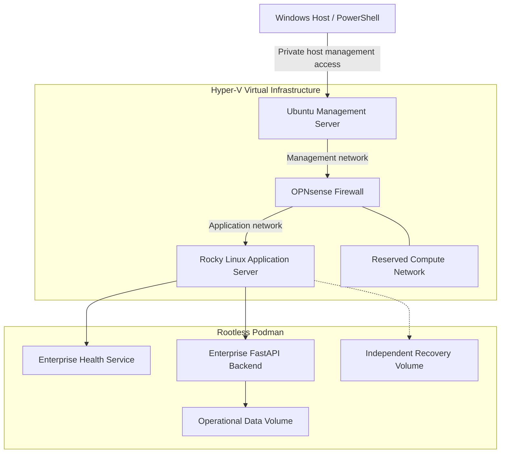
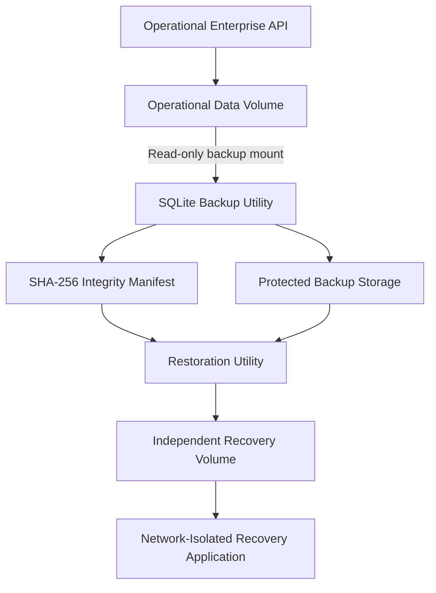

# Infrastructure Architecture

## 1. Overview

This project implements a locally hosted, security-focused enterprise network
and private cloud infrastructure using Hyper-V virtualization, OPNsense,
Linux servers, rootless containers and infrastructure automation.

The architecture demonstrates network segmentation, controlled service
exposure, secure administrative access, offline application deployment,
persistent data management and operational resilience.

The infrastructure operates within a controlled laboratory environment using
fictional enterprise data and locally managed resources.

## 2. Physical Infrastructure

| Component | Specification |
|---|---|
| Host operating system | Windows 10 Pro |
| Processor | Intel Core i5-10400F |
| Processor cores | 6 physical cores, 12 logical processors |
| Physical memory | 16 GB |
| Virtualization platform | Microsoft Hyper-V |
| Infrastructure storage | Dedicated local engineering workspace |
| External cloud dependencies | None required for runtime |

## 3. Virtual Infrastructure

| Virtual machine | Operating system | Role | Assigned memory |
|---|---|---|---:|
| LAB-FW-01 | OPNsense | Firewall and network segmentation | 2048 MiB |
| LAB-MGMT-01 | Ubuntu Server | Infrastructure management and automation | 1536 MiB |
| LAB-APP-01 | Rocky Linux | Application and container hosting | 2048 MiB |

Total assigned virtual machine memory: 5632 MiB.

The management and application responsibilities are separated across dedicated
virtual machines rather than consolidated into a single operating system.

## 4. Network Architecture



## 5. Network Addressing

| Network | Subnet | Purpose |
|---|---|---|
| Management | 10.20.10.0/24 | Infrastructure administration |
| Application | 10.20.20.0/24 | Enterprise application hosting |
| Compute | 10.20.30.0/24 | Reserved computing infrastructure |
| Host management | 10.20.40.0/24 | Windows-to-Ubuntu administration |
| Isolated WAN segment | 172.30.100.0/24 | Firewall interface without an upstream gateway |
| Health container network | 10.89.50.0/24 | Internal application container network |
| Enterprise API network | 10.89.60.0/24 | Dedicated internal backend network |

### Infrastructure Addresses

| Component | Address |
|---|---|
| OPNsense management gateway | 10.20.10.1 |
| OPNsense application gateway | 10.20.20.1 |
| OPNsense compute gateway | 10.20.30.1 |
| OPNsense isolated WAN interface | 172.30.100.1 |
| Ubuntu management interface | 10.20.10.10 |
| Ubuntu host management interface | 10.20.40.10 |
| Rocky application interface | 10.20.20.10 |

The compute network is reserved for future infrastructure expansion.
Distributed computing workloads are outside the implemented project scope.

Additional addressing information is maintained in
[network-addressing.md](../network-addressing.md).

## 6. Administrative Access Architecture

Windows provides the administrative entry point through PowerShell.

Ubuntu acts as the infrastructure management server and executes Ansible,
Python validation utilities and SSH-based administrative operations.

Rocky Linux is administered using a dedicated, passphrase-protected ED25519
SSH identity.


SSH host key verification is enforced.

The Windows orchestration utility uses an existing Ubuntu SSH authentication
agent through a protected local socket reference.

Passwords, private keys and passphrases are not stored in the orchestration
script. SSH agent forwarding is not required.

## 7. Application Architecture

Two operational applications are hosted on Rocky Linux using rootless Podman.

### Enterprise Health Service

| Property | Configuration |
|---|---|
| Container | enterprise-health |
| Version | 1.0.1 |
| Runtime | Python HTTP server |
| Container network | enterprise-private |
| Published endpoint | 10.20.20.10:8080 |
| Application identity | UID/GID 10001 |
| Memory limit | 128 MiB |
| Process limit | 32 |

The service demonstrates application deployment, version management,
health validation, graceful shutdown and automated rollback.

Application access is restricted through OPNsense and the Rocky host firewall.

### Enterprise API

| Property | Configuration |
|---|---|
| Container | enterprise-api |
| Framework | FastAPI |
| Application server | Uvicorn |
| Python runtime | Python 3.13 |
| Container network | enterprise-api-private |
| Container port | 8000/tcp |
| Published endpoint | 127.0.0.1:18000 |
| Application identity | UID/GID 10001 |
| Memory limit | 256 MiB |
| Process limit | 32 |
| Persistent volume | enterprise-api-data |

The backend is an integrated application originating from a separate
enterprise API and backend security engineering project.

It includes:

- Financial data ingestion and reconciliation.
- Departmental project data management.
- Authentication through a centralized identity registry.
- Explicit role-based authorization.
- Confidential document protection.
- Operational ingestion monitoring.
- Persistent security audit logging.

The operational data volume contains 174 fictional financial transactions
and five fictional departmental project records.

## 8. Restricted Enterprise API Access

The enterprise API is published exclusively on the Rocky host loopback
interface.

Management access is provided through SSH local port forwarding rather
than direct application network exposure.


This design allows authenticated backend requests to traverse the existing
encrypted administrative connection without opening another firewall port.

Direct access from the Ubuntu management server to the Rocky application
address on TCP port 18000 was tested and did not succeed.

## 9. Container Security Architecture

Both operational applications use security-restricted rootless containers.

The implemented controls include:

- Non-root application execution.
- Read-only container root filesystems.
- Removal of Linux capabilities.
- Prevention of privilege escalation.
- Memory and process limits.
- Explicitly restricted host port publishing.
- Dedicated internal container networks.
- Offline image deployment with external image pulls disabled.

The enterprise API additionally uses an explicitly empty, read-only resolver
configuration and an environment setting that disables the OpenTelemetry SDK.

Runtime validation confirmed the absence of default IPv4 and active default
IPv6 routes inside the enterprise API container.

These controls reduce network exposure and application privileges. They do
not constitute a universal guarantee against unrelated host-level monitoring
or every possible communication mechanism.

## 10. Persistent Storage Architecture

Application data is stored independently of the enterprise API container.

| Resource | Purpose |
|---|---|
| enterprise-api-data | Operational application databases and audit records |
| enterprise-api-recovery | Independent disaster recovery storage |
| Protected backup directory | Versioned database backups and integrity manifests |

The operational volume contains:

```text
/app-data/
    enterprise.db
    identity.db
    logs/
        security_audit.jsonl
```

Both database files were verified to have ownership UID/GID 10001 and
permissions 0600.

Persistent data remained available following application container replacement.

## 11. Backup and Recovery Architecture



The backup process uses SQLite's native backup API and validates database
integrity before publishing the completed backup.

A separate restoration utility verifies file sizes and SHA-256 checksums
before restoring the databases and audit log into independent storage.

The recovery exercise demonstrated successful restoration of all 174
financial transactions, five departmental projects and 23 historical
security audit events.

The original operational data volume was not mounted by the recovery
application.

## 12. Infrastructure Automation

Ansible provides reproducible infrastructure and application management.

Automation covers:

- Rocky application server baseline configuration.
- Offline container base image preparation.
- Application image building.
- Application firewall configuration.
- Internal container network provisioning.
- Hardened application deployment.
- Version upgrades and rollback.
- Enterprise backend deployment.
- Runtime security validation.
- Application health verification.

The final centralized deployment completed with 40 successful Ansible tasks,
zero changes, zero failures and zero unreachable hosts.

## 13. Operational Monitoring

A Python monitoring utility executes from the Ubuntu management server.

It collects:

- HTTP service availability.
- Application health responses.
- Response latency.
- Operational container state.
- Storage utilization and available capacity.
- Overall infrastructure health.

The utility produces structured JSON reports and returns a nonzero exit
code when infrastructure health is degraded.

A controlled service interruption and recovery exercise validated failure
detection and subsequent recovery recognition.

## 14. Windows Orchestration

The PowerShell management utility provides four administrative actions.

| Action | Purpose |
|---|---|
| Status | Inspect Hyper-V virtual machine status |
| Validate | Validate Ansible deployment syntax |
| Monitor | Execute centralized infrastructure monitoring |
| Deploy | Reconcile both operational applications |

All four actions were successfully executed.

Hyper-V status inspection requires an appropriately authorized Windows
administrative session.

## 15. Architecture Decisions

| Decision | Engineering rationale |
|---|---|
| Hyper-V virtualization | Local infrastructure separation |
| OPNsense firewall | Network segmentation and controlled communication |
| Separate management server | Centralized administration and automation |
| Rocky Linux application server | Enterprise Linux hosting and security controls |
| Rootless Podman | Reduced container privilege requirements |
| Offline image deployment | Avoid runtime dependency on external registries |
| Dedicated internal networks | Separate application networking |
| SSH port forwarding | Encrypted administrative backend access |
| Persistent volumes | Separate application data from container lifecycle |
| Independent recovery storage | Test restoration without overwriting operational data |
| Ansible | Reproducible infrastructure reconciliation |
| Python monitoring | Lightweight dependency-free operational validation |
| PowerShell orchestration | Centralized Windows administrative entry point |

## 16. Scope and Limitations

This project is a controlled enterprise infrastructure engineering laboratory,
not a production-certified private cloud platform.

The following capabilities are outside the implemented scope:

- Multi-host high availability.
- Distributed container orchestration.
- Production certificate lifecycle management.
- Enterprise identity federation.
- Distributed observability platforms.
- Off-site disaster recovery.
- Hardware redundancy.
- Production performance and capacity benchmarking.

Backups and recovery volumes reside within the same physical laboratory
environment. They demonstrate application-level data recovery, but do not
provide protection against loss of the entire physical host.

The enterprise API uses fictional demonstration identities and must not be
exposed as a production authentication service.

All reported validation results refer to the implemented laboratory
configuration and the specific tests performed.
