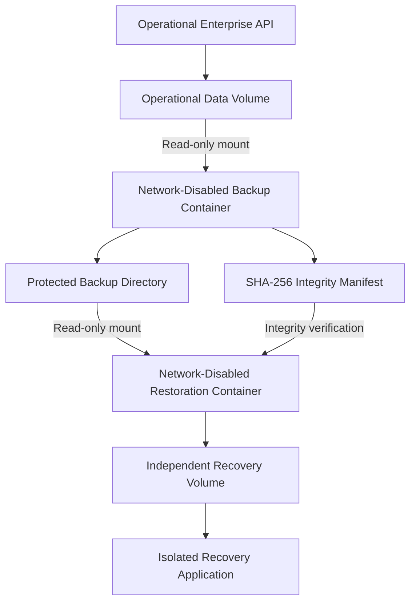

# Enterprise Backup and Disaster Recovery

## 1. Overview

The enterprise infrastructure implements application-level backup and
disaster recovery for the integrated FastAPI backend.

The recovery architecture separates persistent application data from
the container lifecycle and provides a reproducible mechanism for
creating, validating and restoring application backups.

The recovery procedures were implemented and exercised within the
controlled laboratory environment using fictional enterprise data.

## 2. Recovery Objectives

The implemented recovery mechanism addresses the following objectives:

- Preserve financial transactions and departmental project records.
- Preserve the application identity registry.
- Preserve historical security audit records.
- Verify backup integrity before restoration.
- Restore data independently of operational application storage.
- Validate application functionality using recovered data.
- Prevent accidental modification of operational databases.
- Maintain operational application availability during recovery testing.

## 3. Persistent Storage Inventory

| Resource | Purpose |
|---|---|
| enterprise-api-data | Operational enterprise application storage |
| enterprise-api-recovery | Independent disaster recovery storage |
| enterprise-api-backups | Protected filesystem backup directory |
| enterprise-api-config | Dedicated application and recovery configuration |

The operational and recovery environments use separate Podman volumes.

The backup directory resides on the Rocky Linux application server:

```text
/home/labadmin/enterprise-api-backups
```

The backup directory is separate from both application volumes.

## 4. Protected Application Data

The enterprise backup protects three application files.

| File | Purpose |
|---|---|
| enterprise.db | Financial transactions, departmental projects and ingestion history |
| identity.db | Application identity registry and credential hashes |
| logs/security_audit.jsonl | Historical application security decisions |

The operational dataset used during the recovery exercise contained:

| Data category | Records |
|---|---:|
| Financial transactions | 174 |
| Departmental projects | 5 |
| Historical security audit events | 23 |

All application data and demonstration identities are fictional.

## 5. Recovery Architecture



The independent recovery application does not mount the operational
application volume.

## 6. Backup Implementation

The reusable backup utility is located at:

```text
scripts/backup_enterprise_api.py
```

The utility uses Python standard library modules and requires no
additional external dependencies.

### Backup Methodology

The backup process performs the following operations:

1. Creates a uniquely timestamped backup directory.
2. Opens the operational SQLite databases in read-only mode.
3. Creates consistent database copies using SQLite's native backup API.
4. Executes SQLite integrity checks against the backup databases.
5. Copies the historical security audit log.
6. Validates the audit log's JSON records.
7. Calculates SHA-256 checksums for all protected files.
8. Records file sizes and checksums in a manifest.
9. Publishes the completed backup directory.

Incomplete backup directories are removed if backup creation fails.

Completed backups use unique UTC timestamps to avoid replacing
previous recovery points.

## 7. Backup Directory Structure

Each completed backup has the following structure:

```text
enterprise-api-TIMESTAMP/
    enterprise.db
    identity.db
    logs/
        security_audit.jsonl
    manifest.json
```

The manifest identifies the application, creation timestamp,
protected files, file sizes and SHA-256 checksums.

The manifest covers the three protected application files.

It is not digitally signed and does not provide independent
authentication against deliberate modification.

## 8. Backup Security Controls

| Control | Implementation |
|---|---|
| Container runtime | Rootless Podman |
| Application identity | UID/GID 10001 |
| Container networking | Disabled |
| Operational database mount | Read-only |
| Root filesystem | Read-only |
| Linux capabilities | All dropped |
| Privilege escalation | Disabled |
| Backup directory permissions | 0700 |
| Backup file permissions | 0600 |
| External image pulls | Prohibited |
| Memory limit | 256 MiB |
| Process limit | 32 |

Backup operations do not intentionally contact external services,
cloud infrastructure or third-party storage providers.

## 9. Backup Execution Procedure

The backup utility is transferred from the authoritative Windows
repository to the Ubuntu management server and then to Rocky Linux.

On Rocky, the utility is stored at:

```text
/home/labadmin/enterprise-api-config/backup_enterprise_api.py
```

The backup directory must exist and have appropriate ownership
within the rootless Podman user namespace.

Before initiating a backup, confirm that the operational enterprise
API is running and that no conflicting maintenance is active.

A controlled application maintenance window is required to obtain
consistency across both SQLite databases and the audit log.

The following reference procedure is executed on Rocky under the
dedicated rootless Podman administrative account.

```bash
(
set -euo pipefail

test "$(podman inspect --format '{{.State.Running}}' enterprise-api)" = "true"

# Attempt application restart when maintenance finishes.
restart_api() {
    result=$?
    trap - EXIT

    if ! podman start enterprise-api; then
        echo "Application restart failed"
        exit 1
    fi

    exit "$result"
}

trap restart_api EXIT

podman stop --time 30 enterprise-api

# Create the backup with operational data mounted read-only.
podman run --rm \
    --name enterprise-api-backup \
    --pull=never \
    --network=none \
    --read-only \
    --cap-drop=ALL \
    --security-opt=no-new-privileges \
    --memory=256m \
    --pids-limit=32 \
    --user=10001:10001 \
    --env=PYTHONDONTWRITEBYTECODE=1 \
    --env=OTEL_SDK_DISABLED=true \
    --volume=enterprise-api-data:/app-data:ro,Z \
    --volume=/home/labadmin/enterprise-api-backups:/backups:Z \
    --volume=/home/labadmin/enterprise-api-config/backup_enterprise_api.py:/backup_enterprise_api.py:ro,Z \
    --entrypoint=python \
    bc7263629e45 \
    /backup_enterprise_api.py
)
```

The restart mechanism attempts to restore application availability
even when backup creation fails.

This mechanism does not guarantee recovery from physical host
failure, abrupt power loss or forced process termination.

Following maintenance, independently verify application health.

```bash
curl --noproxy "*" --fail --silent --show-error \
    --max-time 5 http://127.0.0.1:18000/health
```

The operational API must return a healthy response before the
maintenance operation is considered complete.

## 10. Restoration Implementation

The reusable restoration utility is located at:

```text
scripts/restore_enterprise_api.py
```

The utility implements the following restoration controls:

- Validates the supplied backup directory name.
- Requires the expected backup manifest.
- Verifies the application identifier.
- Requires the exact expected protected file inventory.
- Rejects missing files and symbolic links at expected file paths.
- Verifies file sizes.
- Verifies SHA-256 checksums.
- Refuses to overwrite nonempty recovery storage.
- Restores files with restrictive permissions.
- Recalculates restored file checksums.
- Executes restored SQLite integrity checks.
- Validates restored audit records.

All protected backup files are validated before restoration begins.

If restoration fails after files have been written, the recovery
volume must be inspected before another restoration attempt.

The utility does not automatically delete existing recovery data.

## 11. Recovery Volume Preparation

Independent recovery storage must exist before restoration.

The recovery volume used during the exercise was:

```text
enterprise-api-recovery
```

For a new recovery exercise, create a separate empty Podman volume.

The following procedure must only be executed when the named recovery
volume does not already exist.

```bash
(
set -euo pipefail

if podman volume exists enterprise-api-recovery; then
    echo "Recovery volume already exists. Stopping."
    exit 1
fi

podman volume create enterprise-api-recovery

volume_path=$(podman volume inspect \
    --format '{{.Mountpoint}}' enterprise-api-recovery)

podman unshare chown 10001:10001 "$volume_path"
podman unshare chmod 0700 "$volume_path"
)
```

The recovery volume must have ownership UID/GID 10001 and
directory permissions 0700.

The operational application volume must not be removed, replaced
or mounted by the recovery application.

## 12. Restoration Execution Procedure

Select an explicitly identified completed backup directory.

The restoration utility is stored on Rocky at:

```text
/home/labadmin/enterprise-api-config/restore_enterprise_api.py
```

The following reference command restores a selected backup into an
empty recovery volume.

Replace BACKUP_NAME with the exact verified backup directory name
before execution.

```bash
podman run --rm \
    --name enterprise-api-restore \
    --pull=never \
    --network=none \
    --read-only \
    --cap-drop=ALL \
    --security-opt=no-new-privileges \
    --memory=256m \
    --pids-limit=32 \
    --user=10001:10001 \
    --env=PYTHONDONTWRITEBYTECODE=1 \
    --env=OTEL_SDK_DISABLED=true \
    --volume=/home/labadmin/enterprise-api-backups:/backups:ro,Z \
    --volume=enterprise-api-recovery:/recovery:Z \
    --volume=/home/labadmin/enterprise-api-config/restore_enterprise_api.py:/restore_enterprise_api.py:ro,Z \
    --entrypoint=python \
    bc7263629e45 \
    /restore_enterprise_api.py BACKUP_NAME
```

The backup directory is mounted read-only.

Only the independent recovery volume receives restored application data.

The operational enterprise API can remain running throughout the
restoration process.

## 13. Functional Recovery Validation

Successful database restoration is not sufficient to establish
application recoverability.

An independent recovery application was therefore launched using
the restored databases.

| Property | Recovery configuration |
|---|---|
| Container | enterprise-api-recovery-test |
| Application image | Locally imported enterprise API image |
| Persistent volume | enterprise-api-recovery |
| Container networking | Disabled |
| Published host ports | None |
| Application identity | UID/GID 10001 |
| Root filesystem | Read-only |
| Memory limit | 256 MiB |
| Process limit | 32 |

The recovery application successfully initialized its Uvicorn
application server.

The functional validation procedure covered:

- Application health.
- Missing authentication rejection.
- Employee authentication.
- Confidential document access restrictions.
- Finance authentication.
- Financial reporting.
- Ingestion history retrieval.
- AI service financial access restrictions.

All application requests were restricted to the recovery container's
own loopback interface.

The recovery exercise also generated seven additional security audit
events in the independent recovery environment.

## 14. Verified Recovery Results

The restoration exercise produced the following results.

| Validation | Result |
|---|---|
| Original backup checksums | 3/3 verified |
| Restored file checksums | 3/3 verified |
| Enterprise database integrity | Passed |
| Identity database integrity | Passed |
| Financial transactions recovered | 174/174 |
| Departmental projects recovered | 5/5 |
| Historical audit events recovered | 23/23 |
| Independent recovery application startup | Passed |
| Independent audit storage | Passed |
| Recovery application graceful shutdown | Passed |
| Operational application availability | Maintained |

## 15. Operational Data Separation

Following recovery application testing, both environments were
independently inspected.

| Environment | Security audit records |
|---|---:|
| Operational enterprise API | 23 |
| Independent recovery application | 30 |

The recovery application generated seven additional audit records
without modifying the operational audit history.

The operational and recovery containers used different persistent
volumes.

The independent recovery application was gracefully stopped after
validation.

Its restored data volume was retained for subsequent inspection.

Both operational applications remained running.

## 16. Recovery Acceptance Criteria

A recovery exercise is considered successful when:

- All expected backup files are present.
- File sizes and SHA-256 checksums match the manifest.
- Both restored databases pass SQLite integrity validation.
- Expected application data is present.
- The recovered application starts successfully.
- Authentication and authorization behave as expected.
- Financial data remains accessible to authorized identities.
- New security audit records are written independently.
- Operational data remains protected.
- Operational application health is maintained.

A successful file restoration alone does not satisfy all recovery
acceptance criteria.

## 17. Failure Handling

### Backup Integrity Failure

If a checksum or file size does not match the manifest:

- Stop the restoration operation.
- Preserve the original backup.
- Investigate the integrity discrepancy.
- Select another independently validated backup if available.

Do not modify manifest values merely to bypass validation.

### Nonempty Recovery Volume

The restoration utility deliberately rejects nonempty storage.

Inspect the existing recovery resources and create a separate,
uniquely named recovery volume when necessary.

Do not automatically delete the existing recovery volume.

### Database Integrity Failure

Preserve the failed restoration environment for investigation.

Do not promote a database that fails SQLite integrity validation
into the operational environment.

### Application Startup Failure

Inspect recovery container logs, restored file permissions and
application configuration.

Keep the operational application separate from the failed
recovery environment.

### Operational API Restart Failure

Inspect the operational container state and startup logs.

Use the existing enterprise API deployment automation to
reconcile a compliant application configuration where appropriate.

Verify health independently before completing maintenance.

## 18. Recovery Scope and Limitations

The implemented architecture demonstrates application-level backup
and recovery within a single physical laboratory environment.

The backup directory, operational volume and recovery volume reside
on the same application server and physical virtualization host.

Consequently, the implementation does not protect against complete
loss of the physical host or its underlying storage.

The following capabilities are outside the implemented scope:

- Automatic scheduled backup execution.
- Cross-host backup replication.
- Off-site disaster recovery.
- Encrypted backup storage at rest.
- Digitally signed backup manifests.
- Continuous database replication.
- Automated production failover.
- Formal recovery time objective guarantees.
- Formal recovery point objective guarantees.
- Enterprise backup retention and compliance policies.

Recovery point and recovery time objectives were not formally
benchmarked or contractually defined.

The recovery exercise demonstrates the practical ability to preserve,
validate and restore enterprise application data without overwriting
the operational environment.

## 19. Supporting Evidence

| Evidence | Description |
|---|---|
| 61 | Enterprise database backup and service recovery |
| 62 | Backup integrity and independent restoration |
| 63 | Functional disaster recovery validation |
| 64 | Recovery data separation and cleanup |

Additional evidence references are maintained in
[Evidence Index](evidence-index.md).

The backup archives, security logs, credential databases and runtime
storage artifacts are intentionally excluded from version control.