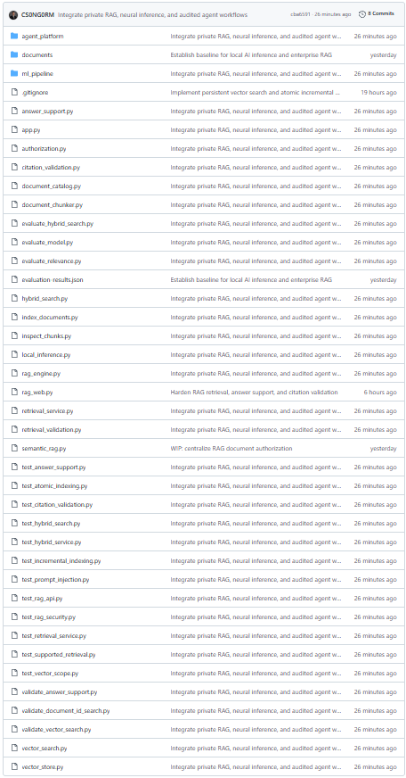

# Private AI & Machine Learning Platform

An interdisciplinary AI engineering project combining local language-model inference, retrieval-augmented generation, machine learning, neural-network anomaly detection, secure agent orchestration, and enterprise data governance within a controlled local environment.

## Private Source Repository: Implementation Evidence

The complete engineering implementation is maintained in a separate private GitHub repository. The screenshot below shows the actual source repository structure, including the retrieval infrastructure, machine-learning pipeline, agent platform, validation components, and automated tests.

Actual GitHub repository structure showing the privately maintained engineering implementation. Source files are not publicly accessible.

[View the Private Source Repository](https://docs.google.com/forms/d/e/1FAIpQLSeHfeRNk7JC-WSdeVipiqP8JlBd00hrx2ef6kMKXSpLqQexGA/viewform?usp=publish-editor)(access restricted to authorized accounts)

Technical walkthroughs: Full implementation reviews and selected source demonstrations are available upon request for professional evaluation.

## Project Overview

Enterprise AI systems must balance analytical capability, information accessibility, data security, model reliability, and operational control. Integrating language models, machine-learning pipelines, and automated agents introduces additional challenges around authorization, validation, explainability, and execution auditing.

This project explores how these requirements can be addressed through a locally operated enterprise AI platform using entirely fictional business data.

Rather than developing retrieval-augmented generation, predictive analytics, and agent orchestration as isolated applications, the platform integrates them through explicit interfaces, role-based permissions, validated execution workflows, and persistent audit records.

The implementation incorporates local language-model inference, hybrid document retrieval, comparative machine-learning evaluation, registered neural-network inference, and controlled multi-step business workflows.

**Implementation availability:** This public repository contains a curated technical showcase. The complete source code, trained model artifacts, and internal engineering implementation are maintained separately in a private repository.

## Engineering Objectives

- Develop a private retrieval-augmented generation system using locally operated language models and embeddings.
- Implement semantic and hybrid document retrieval with authorization-aware filtering.
- Validate retrieved evidence, citations, and answer support.
- Develop and evaluate anomaly-detection models using fictional enterprise transaction data.
- Implement registered neural-network inference with artifact integrity verification.
- Build a structured AI-agent execution platform with explicit tool permissions.
- Enforce input validation, bounded workflows, and consistent execution failure handling.
- Maintain persistent execution records and auditable workflow outcomes.
- Verify integrated system behavior through automated regression and reliability testing.

## Technology Stack

| Area | Technologies |
|---|---|
| Programming | Python 3.13 |
| Local LLM Infrastructure | Ollama, Qwen3 1.7B |
| Embeddings | EmbeddingGemma |
| Retrieval | Semantic search, hybrid retrieval, SQLite-backed vector indexing |
| Machine Learning | scikit-learn, Isolation Forest, Random Forest, MLP neural network |
| Data Processing | pandas, NumPy |
| Model Management | joblib, SHA-256 artifact verification |
| Agent Orchestration | Python-based task planner, workflow engine, role-based tool permissions |
| Persistence | SQLite |
| Testing | Python unittest |
| Development | Git, PowerShell, VS Code |

## Verification Summary

| Component | Result |
|---|---|
| Private RAG regression tests | 94 passed |
| Machine-learning regression tests | 32 passed |
| Agent-platform regression tests | 134 passed |
| **Total automated tests** | **260 passed, 0 failed** |
| Registered neural-network inference | Successful |
| Combined RAG and ML risk-review workflow | Successful |
| Role-based authorization | Verified in automated tests |
| SQLite execution persistence | Verified in automated tests |
| Technical failure handling | Verified in automated tests |

The combined workflow uses fictional, mocked RAG retrieval metadata and genuine locally trained neural-network inference. The standalone RAG implementation separately supports local model inference and semantic retrieval.

## System Architecture

The platform combines three engineering domains within a controlled local environment:

1. **Private RAG:** Local model inference, document indexing, hybrid retrieval, authorization, and citation validation.
2. **Machine Learning:** Synthetic data generation, feature engineering, model evaluation, registered neural inference, and integrity verification.
3. **Agent Platform:** Structured task planning, role-based authorization, bounded execution, failure handling, and SQLite auditing.

The components are designed to remain independently testable while supporting controlled integration through explicit interfaces.

---

The following sections document the technical implementation, verification evidence, security controls, and known limitations.