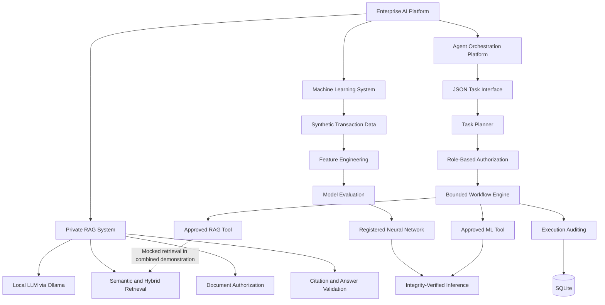

# System Architecture

[Explore the system architecture](architecture/system-architecture.md)

## Architecture Overview

The Private AI & Machine Learning Platform combines three independently developed engineering components: retrieval-augmented generation, machine-learning inference, and structured agent orchestration.

## 1. Private RAG Architecture

The standalone RAG system implements local inference and authorized document retrieval.

Its responsibilities include semantic indexing, hybrid retrieval, document access checks, citation validation, and answer-support verification.

Retrieved content is treated as untrusted input rather than an instruction source.

## 2. Machine-Learning Architecture

The machine-learning subsystem processes fictional enterprise transactions and evaluates multiple anomaly-detection approaches.

Its registered neural-network pipeline verifies the expected model identity, feature configuration, artifact path, and SHA-256 digest before local inference.

The resulting anomaly scores represent classifier outputs, not calibrated real-world fraud probabilities.

## 3. Agent Orchestration Architecture

The agent platform accepts bounded, structured JSON requests and converts approved tasks into explicitly authorized workflow steps.

The controller enforces tool-level permissions, and the workflow engine records execution outcomes.

Execution results distinguish completed workflows, authorization or validation rejections, and technical failures.

SQLite stores the final execution response for later retrieval.

## 4. Integration Boundaries

The agent platform supports two approved analytical capabilities:

| Capability | Integration |
|---|---|
| Document retrieval | Authorized fictional retrieval metadata in the combined demonstration |
| Anomaly prediction | Genuine registered local neural-network inference |

The combined risk-review workflow executes document retrieval followed by anomaly prediction under a single workflow engine.

Both operations must be authorized before execution begins. If the first operation fails, the second does not execute.

## 5. Security Boundaries

The architecture separates request validation, task planning, permission enforcement, tool execution, and persistence.

Key controls include strict JSON schemas, bounded transaction batches, approved model identifiers, role-based tool permissions, document authorization, artifact integrity checks, sanitized technical errors, and auditable execution outcomes.

The demonstrated architecture uses fictional data and controlled local components. It is not presented as a production-certified or externally audited security system.

## 6. Engineering Limitations

The public architecture deliberately omits operational configuration and complete implementation details.

The combined agent demonstration uses mocked RAG retrieval rather than the standalone live retrieval backend. Registered model hashing validates artifact consistency against the local manifest but does not independently establish its provenance.

Automated tests and functional demonstrations provide evidence for the exercised scenarios, not guarantees about all possible operating conditions.
