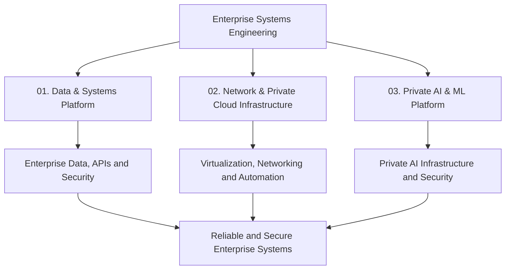

# Systems & Infrastructure Engineering Portfolio

A collection of hands-on engineering projects exploring enterprise systems, infrastructure architecture, network security, data platforms, automation, cybersecurity and secure AI integration.

The projects focus on designing, implementing and validating practical systems within controlled laboratory environments using fictional enterprise data.

## Engineering Projects

| Project | Focus | Core Technologies |
|---|---|---|
| [01. Secure Enterprise Data & Systems Platform](01-enterprise-api-security/) | Enterprise APIs, financial integrity, cybersecurity and data engineering | Python, FastAPI, SQLite, Docker, Prefect |
| [02. Secure Enterprise Network & Private Cloud Infrastructure](02-secure-enterprise-network-private-cloud/) | Virtualization, network segmentation, Linux infrastructure, automation and disaster recovery | Hyper-V, OPNsense, Ubuntu, Rocky Linux, Ansible, Podman |
| [03. Private AI & ML Platform](03-private-ai-ml-platform/) | Private AI infrastructure, local model integration and AI security | Python, local AI/ML infrastructure, security testing |

## Engineering Focus

The portfolio combines several complementary disciplines:

- **Software and systems engineering:** Application architecture, enterprise APIs, persistent storage and service integration.
- **Data engineering:** Data ingestion, validation, transactional processing and financial integrity.
- **Infrastructure engineering:** Virtualization, Linux administration, containerization and infrastructure automation.
- **Network security:** Segmentation, routing controls, firewall policies and encrypted administrative access.
- **Cybersecurity:** Authentication, authorization, least privilege, audit logging and security validation.
- **AI engineering and security:** Private AI infrastructure, model integration and controlled adversarial testing.
- **Systems reliability:** Automated testing, monitoring, rollback, backup and recovery.

## Project Architecture

Each project has its own documentation, implementation details, engineering results and known limitations.

## Technology Stack

| Domain | Technologies |
|---|---|
| Programming | Python, PowerShell, Bash |
| Backend Engineering | FastAPI, Uvicorn |
| Databases | SQLite |
| Virtualization | Microsoft Hyper-V |
| Network Security | OPNsense, firewalld, SSH |
| Linux | Ubuntu Server, Rocky Linux |
| Containers | Docker, Docker Compose, rootless Podman |
| Infrastructure Automation | Ansible |
| Workflow Orchestration | Prefect |
| AI and Machine Learning | Private AI/ML tooling and local model infrastructure |
| Testing | Pytest, Python unittest, application and infrastructure security tests |
| Development and Version Control | Visual Studio Code, Git, GitHub |
| Technical Documentation | Markdown, Mermaid |

## Engineering Approach

Projects emphasize:

1. Clearly defined objectives and architecture.
2. Practical implementation using controlled environments.
3. Explicit security boundaries and least-privilege operation.
4. Automated testing and independent validation.
5. Evidence-based findings and documented limitations.
6. Operational reliability, maintainability and recovery.

## Security and Ethical Scope

Security exercises are conducted only against locally controlled, authorized systems using fictional information.

Project documentation distinguishes verified implementation results from simulations, assumptions and capabilities outside the tested scope.

The projects are engineering demonstrations and are not represented as production-certified enterprise platforms.

## Project Status

The three project directories contain their respective implementations and technical documentation. Refer to each project README for its individual verification results, completion status and limitations.